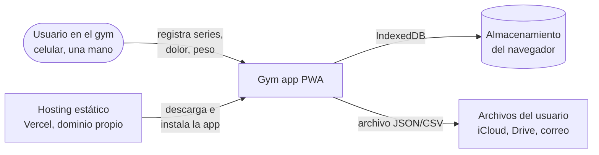
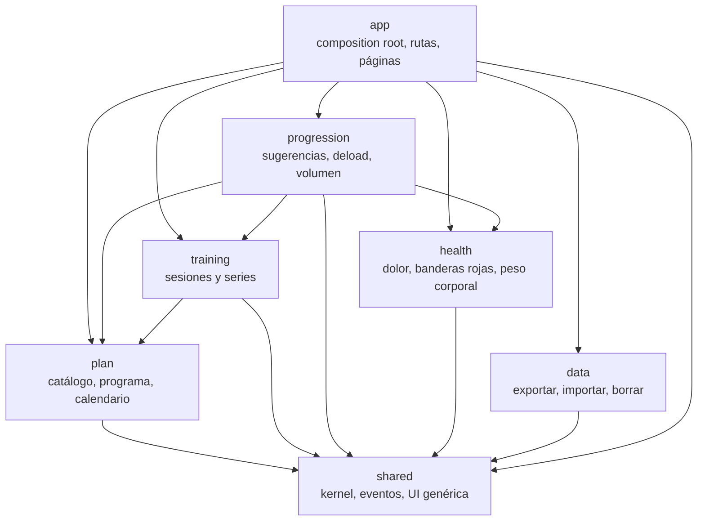
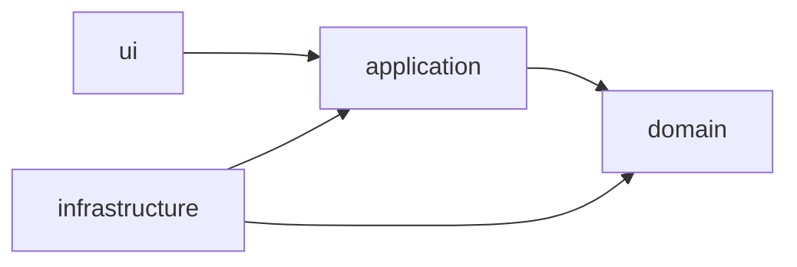
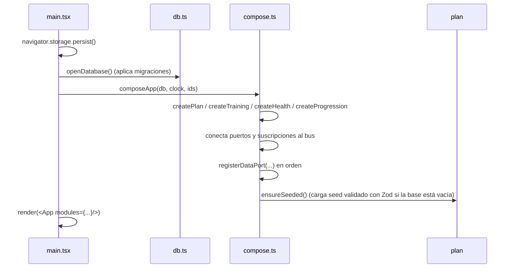
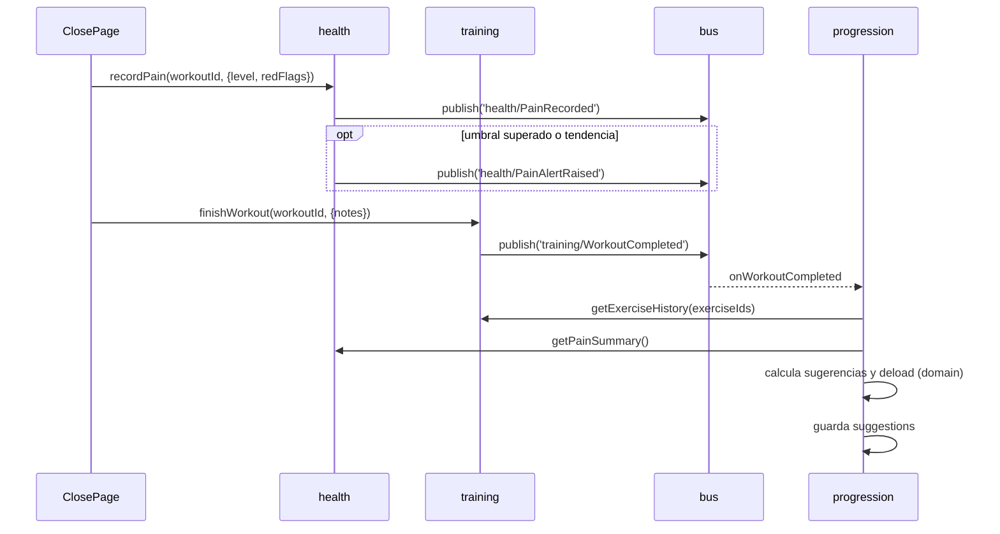
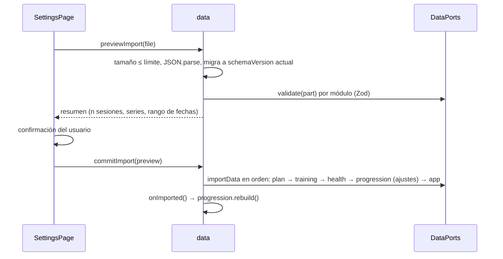
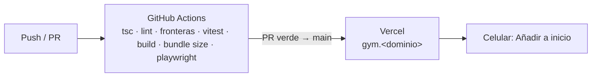

# Arquitectura

**Versión:** 1.3 · **Fecha:** 17-nov-2026 · **Basado en:** `spec.md` v0.6 · **Formato:** arc42 reducido

Este documento describe **cómo** está construida la app. El **qué** está en [`spec.md`](spec.md); los **porqués** en [`adr/`](adr/README.md); el contrato detallado de cada módulo en [`modules/`](modules/).

---

## 1. Objetivos de arquitectura

Ordenados por prioridad. Cuando chocan, gana el de arriba.

| # | Objetivo | De dónde viene | Escenario de calidad |
|---|---|---|---|
| 1 | **Seguridad del usuario:** ninguna salida sugiere ejercicios de riesgo lumbar alto; las alertas de dolor funcionan siempre | P-1 | QS-01, QS-02 |
| 2 | **Integridad de datos:** nada se pierde al cerrar la app, al migrar ni al importar | P-2, RF-13, RF-19, RNF-09 | QS-03, QS-04 |
| 3 | **Velocidad de registro:** una serie en < 5 s y < 100 ms de respuesta, offline | P-6, RNF-01, RNF-02 | QS-05, QS-06 |
| 4 | **Mantenibilidad:** módulos aislados, dominio puro y probado | P-4, P-5, RNF-08 | QS-07, QS-08 |
| 5 | **Evolución:** poder añadir sincronización (v2) sin reescribir módulos | spec §3 | QS-09 |

## 2. Restricciones

| Tipo | Restricción |
|---|---|
| Técnica | SPA estática (PWA) sin servidor en v1; IndexedDB como única persistencia |
| Técnica | React + TypeScript + Vite; navegadores: Safari iOS 16+, Chrome Android, escritorio moderno (RNF-07) |
| Organizativa | Un solo desarrollador; prioriza simplicidad (P-7) |
| Dominio | Restricción clínica lumbar (P-1, spec §2 y §6.5) |
| Privacidad | Datos de salud solo en el dispositivo en v1 (RNF-04) |

## 3. Contexto



- No hay llamadas de red en tiempo de ejecución, salvo la descarga de la app y sus actualizaciones (service worker).
- El único intercambio de datos con el exterior es la exportación e importación manual de archivos.

## 4. Estrategia de solución

| Problema | Solución | ADR |
|---|---|---|
| Separar áreas de negocio sin el costo de varios despliegues | Monolito modular con 5 módulos | [0001](adr/0001-monolito-modular.md) |
| Funcionar sin red y con datos locales | PWA + Workbox + Dexie (IndexedDB) | [0002](adr/0002-pwa-offline-first-dexie.md) |
| Comunicar módulos sin acoplarlos ni crear ciclos | API pública (`index.ts`) + puertos + eventos de dominio | [0003](adr/0003-comunicacion-entre-modulos.md) |
| Gráficas sin romper el presupuesto de bundle | uPlot detrás de un componente `shared/ui/Chart` | [0004](adr/0004-graficas-uplot.md) |
| Estilos con los tokens de la spec | CSS Modules + variables CSS | [0005](adr/0005-css-modules-variables.md) |
| Estado efímero de UI (sesión activa, temporizador) | Zustand; los datos persistentes viven en Dexie | [0006](adr/0006-estado-zustand.md) |
| Datos externos no confiables | Zod (forma) y dominio (reglas) en todas las fronteras de entrada | [0012](adr/0012-validacion-del-seed-zod-y-dominio.md) |
| Que las reglas de módulos no dependan de disciplina | `eslint-plugin-boundaries` + `dependency-cruiser` en CI | [0008](adr/0008-verificacion-de-fronteras.md) |
| Identificadores y tiempo deterministas y probables | UUIDv7 + fechas locales ISO, con `Clock` e `IdGenerator` inyectados | [0009](adr/0009-ids-y-tiempo.md) |
| Errores esperados sin excepciones | Tipo `Result<T, E>` en casos de uso | [0010](adr/0010-manejo-de-errores-result.md) |

## 5. Vista de bloques

### 5.1 Nivel 1: módulos



`data` no importa ningún módulo: recibe sus `DataPort` en el arranque (ver §7.4).

| Módulo | Responsabilidad | Tablas propias | Contrato |
|---|---|---|---|
| `plan` | Catálogo de ejercicios, programa, bloques, plantillas; qué toca hoy | `exercises`, `programs`, `blocks`, `templates` | [modules/plan.md](modules/plan.md) |
| `training` | Sesión en curso, series, historial | `workouts`, `sets` | [modules/training.md](modules/training.md) |
| `progression` | Sugerencia de carga, deload, volumen semanal | `suggestions`, `progressionSettings` | [modules/progression.md](modules/progression.md) |
| `health` | Dolor lumbar, banderas rojas, alertas, peso corporal | `painEntries`, `bodyMetrics`, `healthSettings` | [modules/health.md](modules/health.md) |
| `data` | Exportar/importar JSON y CSV, respaldo, borrado | `dataMeta` | [modules/data.md](modules/data.md) |
| `shared` | Kernel (tipos, `Result`, `Clock`), bus de eventos, UI genérica, tokens | Ninguna | [modules/shared.md](modules/shared.md) |
| `app` | Arranque, `db.ts`, `compose.ts`, router, páginas multimódulo, preferencias de UI | `uiPreferences` | §5.3 |

### 5.2 Nivel 2: capas dentro de un módulo

```
modules/<m>/
  index.ts              API pública (lo único importable desde fuera)
  events.ts             tipos de los eventos que publica
  domain/               entidades, value objects, reglas puras
  application/          casos de uso; ports.ts con lo que necesita de fuera
  infrastructure/       repositorios Dexie, schema.ts, mapeadores, dataPort
  ui/                   componentes propios del módulo
  __tests__/
```



| Capa | Puede importar | No puede importar |
|---|---|---|
| `domain` | `shared/kernel` | `application`, `infrastructure`, `ui`, React, Dexie |
| `application` | `domain`, `shared/kernel`, `shared/events`, API pública de módulos permitidos | `infrastructure`, `ui`, Dexie |
| `infrastructure` | `domain`, `application/ports`, Dexie | `ui` |
| `ui` | `application` (casos de uso), `domain` (tipos), `shared/ui`, `dexie-react-hooks` | `infrastructure` |
| `index.ts` | Sus propias capas y `shared/kernel` (tipos de `create<Module>(deps)`, como `Clock`), más Dexie | Archivos de otros módulos |

Los hooks reactivos viven en `ui` (`ui/hooks.ts`), porque `useLiveQuery` necesita Dexie y `application` no puede importarlo. Reciben la API pública del módulo como parámetro (spec 001, plan §6.3).

El cableado de `application` con `infrastructure` lo hace cada módulo en su función `create<Module>(deps)` y la invoca `app/compose.ts`.

### 5.3 Módulo `app`

```
src/app/
  main.tsx        arranque: storage.persist(), registro del SW, render
  db.ts           crea la base Dexie con los esquemas de todos los módulos
  compose.ts      instancia módulos, conecta puertos, registra DataPorts y suscripciones
  router.tsx      rutas (spec §7.2)
  pages/          TodayPage, SessionPage, ClosePage, ProgressPage, SettingsPage
  preferences/    uiPreferences: unidad de visualización (kg/lb), acento
```

Las páginas son las únicas que combinan componentes de varios módulos. Contienen composición, no reglas de negocio.

## 6. Vista de ejecución

### 6.1 Arranque



### 6.2 Registrar una serie (ruta crítica de rendimiento)

```mermaid
sequenceDiagram
  participant UI as SetRow
  participant T as training.logSet
  participant R as SetRepository (Dexie)
  participant B as bus
  UI->>UI: actualización optimista del input
  UI->>T: logSet(setId, {weightKg, reps, rir, done: true})
  T->>T: valida (domain)
  T->>R: put(set)  (una transacción, < 100 ms)
  T->>B: publish('training/SetLogged')
  T-->>UI: Result.ok
  Note over UI: useLiveQuery refleja el cambio;<br/>el temporizador arranca (Zustand)
```

No hay botón "guardar" global: cada serie es una escritura atómica (RF-13).

### 6.3 Cerrar sesión



Si `recordPain` falla, no se llama a `finishWorkout`: la sesión sigue `in_progress` y se puede reintentar. El orden garantiza que `progression` siempre vea el dolor de la sesión cuando recalcula.

### 6.4 Recuperar sesión en curso (RF-19)

Al abrir la app, `TodayPage` consulta `training.getActiveWorkout()`. Si existe un `Workout` con `status: 'in_progress'`, ofrece "Continuar sesión" y navega a `/sesion/:workoutId`, que `SessionPage` redirige con `replace` a `/sesion/:workoutId/:exerciseIndex` del primer ejercicio con series pendientes (o del último si no quedan). El ejercicio actual vive en la URL; Zustand se rehidrata desde Dexie y nunca es la fuente de verdad. Desde "Hoy" también se puede iniciar otra sesión de pesas de la semana actual en `/dia/:date` (spec 002, RN-TRN-14).

### 6.5 Importar datos



La importación es todo o nada: se ejecuta en una sola transacción Dexie sobre todas las tablas afectadas.

## 7. Conceptos transversales

### 7.1 API pública y puertos

- Cada módulo expone en `index.ts` una fábrica `create<Module>(deps)` que devuelve su API, más tipos, componentes públicos y tipos de eventos.
- Si un módulo "de abajo" necesita algo de uno "de arriba", define un **puerto** en `application/ports.ts` y `app/compose.ts` lo conecta. Ejemplo: `training` necesita la sugerencia de peso para prellenar (RF-12), pero `progression` depende de `training`; `training` define `SuggestionProvider` y `compose.ts` inyecta la implementación de `progression`.

### 7.2 Eventos de dominio

- Bus en memoria en `shared/events`, tipado con un mapa de eventos que cada módulo amplía por *declaration merging*:

```ts
// shared/events/types.ts
export interface DomainEvents {}           // vacío en shared

// modules/training/events.ts
declare module '@/shared/events' {
  interface DomainEvents {
    'training/WorkoutCompleted': { workoutId: ID; date: LocalDate; exerciseIds: ID[] };
  }
}
```

- Nombres `<módulo>/<HechoEnPasado>`. El payload es un objeto plano con IDs, nunca entidades completas.
- `publish` es *fire-and-forget*: los handlers corren en microtareas; un fallo se registra y no afecta al publicador.
- Los handlers deben ser **idempotentes**: recalcular a partir del estado persistido, no acumular deltas. Así un evento perdido (app cerrada a mitad) se corrige en el siguiente.
- Se publica **después** de que la escritura en Dexie confirma.

Catálogo completo en cada contrato de módulo; resumen:

| Evento | Publica | Escuchan |
|---|---|---|
| `training/WorkoutStarted` | training | app (Wake Lock, v1.0) |
| `training/SetLogged` | training | progression (volumen, v1.1) |
| `training/WorkoutCompleted` | training | progression |
| `training/WorkoutDiscarded` | training | progression |
| `health/PainRecorded` | health | progression |
| `health/PainAlertRaised` | health | app (aviso en Hoy) |
| `plan/PlanChanged` | plan | progression |

### 7.3 Persistencia

- Una sola base IndexedDB (`gym-app`). Cada módulo declara sus tablas en `infrastructure/schema.ts` y es el único que las lee o escribe.
- `app/db.ts` compone los esquemas y es el único lugar donde se declara `db.version(n)`. Cada módulo aporta sus funciones `upgrade` para la versión en que cambia.
- Escrituras de más de una tabla del mismo módulo van en una transacción. **No hay transacciones entre módulos**, salvo la importación de `data` (§6.5), que es la única excepción permitida.
- La UI lee con `useLiveQuery` a través de hooks expuestos por cada módulo (por ejemplo `useWorkout(id)`), nunca con consultas Dexie directas.
- Las sugerencias de `progression` son una **caché derivada**: se pueden borrar y reconstruir con `progression.rebuild()`. Por eso no se exportan; sí se exportan sus ajustes (`progressionSettings`) [PROPUESTO].
- **Ajustes repartidos por dueño** [PROPUESTO]: la tabla única `settings` de spec §9 se divide en `progressionSettings` (incrementos), `healthSettings` (umbral de dolor, meta de peso) y `uiPreferences` en `app` (unidad de visualización, acento), para que ningún módulo lea tablas ajenas.

Tablas e índices: ver el contrato de cada módulo. La versión 1 de la base solo tiene las tablas de `plan` (spec 001); cada módulo añade las suyas en una versión nueva cuando llega su fase (agregar tablas no requiere `upgrade`). Esquema compuesto objetivo:

```ts
db.version(n).stores({ // n = versión en la que ya existen todas (fin del MVP)
  // plan (versión 1)
  exercises: 'id, name, muscleGroup, lumbarRisk',
  programs: 'id',
  blocks: 'id, programId',
  templates: 'id, blockId',
  // training
  workouts: 'id, date, status, templateId',
  sets: 'id, workoutId, exerciseId, [exerciseId+completedAt]',
  // progression
  suggestions: 'exerciseId',
  progressionSettings: 'id',
  // health
  painEntries: 'id, &workoutId, recordedAt',
  bodyMetrics: 'id, date',
  healthSettings: 'id',
  // data
  dataMeta: 'id',
  // app
  uiPreferences: 'id',
});
```

### 7.4 Exportación e importación

Cada módulo con datos implementa un `DataPort` (la interfaz vive en `shared/kernel`; el contrato completo está en [modules/data.md](modules/data.md)) y `compose.ts` lo registra. Formato:

```json
{ "app": "gym-app", "schemaVersion": 1, "exportedAt": "2026-11-16T22:30:00-06:00",
  "modules": { "plan": { "version": 1, "data": {} }, "training": {}, "health": {}, "progression": {}, "app": {} } }
```

### 7.5 Tiempo, fechas e IDs

- `LocalDate` (`'2026-11-16'`) para el día de entrenamiento en la zona horaria del dispositivo; `Instant` (ISO 8601 con offset) para marcas de tiempo. Nunca se compara un `LocalDate` contra UTC ([ADR-0009](adr/0009-ids-y-tiempo.md)).
- IDs UUIDv7 (ordenables por tiempo, monótonos por dispositivo) generados por `IdGenerator`. Un `Instant` nunca se ordena como string; se usa `compareInstants`.
- `Clock` e `IdGenerator` se inyectan; las pruebas usan versiones fijas.

### 7.6 Unidades

El dominio guarda siempre **kilogramos**. `lb` es solo una preferencia de visualización en `app/preferences`; la conversión ocurre en la UI. Los incrementos por equipo (RF-50) viven en `progressionSettings`, en kg.

### 7.7 Manejo de errores

- Errores esperados (validación, sesión inexistente, umbral) → `Result<T, DomainError>` con un `code` estable, tipado como unión literal por módulo ([ADR-0010](adr/0010-manejo-de-errores-result.md)).
- `DomainError.message` es técnico (inglés, logs). El texto al usuario sale solo del mapa `code → español` en `app`, que cubre todos los códigos (lo verifica `tsc`).
- Errores inesperados → excepción. El *error boundary* de `app` captura errores de render; un handler global de `error`/`unhandledrejection` captura los async (handlers, promesas, Dexie). Ambos muestran un mensaje y la opción de exportar un respaldo.
- `QuotaExceededError` es un error esperado: la infraestructura lo convierte en `'data/storage-full'`, con aviso persistente "Almacenamiento lleno, exporta un respaldo".

### 7.8 Estado de UI

| Tipo | Dónde | Regla |
|---|---|---|
| Persistente | Dexie vía hooks del módulo | Fuente de verdad |
| Sesión activa (temporizador y lo que deba sobrevivir a la navegación) | Zustand `useSessionStore` en `app`, desde la fase 4 | Derivable de Dexie; se rehidrata. El ejercicio actual va en la URL y los borradores de los campos en estado local (spec 002, plan §6.3) |
| Efímero (temporizador, selección de gráfica) | Zustand o `useState` | Se puede perder sin consecuencia |

El temporizador guarda `endsAt` (instante), no un contador, para sobrevivir a la app en segundo plano.

### 7.9 PWA y offline

- `vite-plugin-pwa` con `registerType: 'prompt'`: precache de la app shell; aviso "Hay una versión nueva" y recarga solo con confirmación, **nunca durante una sesión activa**.
- Manifest: `display: standalone`, `theme_color` y `background_color` = `--bg`.
- `navigator.storage.persist()` al primer arranque; el resultado se muestra en Ajustes.

### 7.10 Seguridad

- CSP: `default-src 'self'; script-src 'self'; style-src 'self'; img-src 'self' data:; connect-src 'self'; object-src 'none'; base-uri 'none'; frame-ancestors 'none'` (fuentes autoalojadas; `frame-ancestors` impide meter la app en un iframe). La prueba `tests/architecture/headers.test.ts` lee esta línea y la compara con `vercel.json`.
- Otros headers: `X-Content-Type-Options: nosniff` y `Referrer-Policy: no-referrer`.
- Sin `eval`, `new Function` ni `dangerouslySetInnerHTML` (regla de ESLint).
- Importación: límite de 10 MB [PROPUESTO], validación Zod, vista previa y confirmación.

### 7.11 Accesibilidad e interfaz

- Componentes base en `shared/ui` con mínimo 44 × 44 px y foco visible.
- Inputs numéricos con `inputmode="decimal"` (peso) o `"numeric"` (reps, RIR) y `<label>` asociado.
- Tokens de la spec §7.4 en `shared/ui/tokens.css`; ningún color literal fuera de ese archivo (regla de stylelint en CI).
- Tipografías autoalojadas con `@fontsource-variable/inter` y `@fontsource-variable/space-grotesk`, solo subconjunto latino y `font-display: swap`.

## 8. Despliegue



Hosting: Vercel (Hobby) servido desde un subdominio de un dominio propio, para que el origen (y con él IndexedDB y la PWA instalada) sobreviva a un cambio de proveedor ([ADR-0011](adr/0011-hosting-vercel-origen-estable.md)).

- `main` protegida: cambios por PR con CI obligatorio; Vercel despliega producción desde `main` y previews por PR (solo para revisar, no para instalar).
- Headers, aplicados por `vercel.json`: los de §7.10 en todas las rutas; `Cache-Control: no-cache` en toda ruta fuera de `/assets/` (incluye `/`, rutas de la SPA, `sw.js` y `manifest.webmanifest`: Vercel aplica headers por la ruta pedida, no por el archivo servido); `public, max-age=31536000, immutable` para `/assets/*`; fallback de SPA a `/index.html` solo para rutas sin extensión.
- Sin funciones exclusivas de Vercel: el artefacto es solo `dist/`.

## 9. Escenarios de calidad

Cada escenario se convierte en al menos una prueba automática.

| ID | Atributo | Estímulo | Respuesta esperada | Prueba |
|---|---|---|---|---|
| QS-01 | Seguridad | Cualquier llamada a progresión, deload o sustitución | Nunca devuelve un ejercicio `lumbarRisk: 'high'` | Unitaria con propiedades (todos los ejercicios del catálogo) |
| QS-02 | Seguridad | Se marca una bandera roja al cerrar | No hay sugerencia de subir peso en la siguiente sesión; mensaje destacado | Unitaria + E2E |
| QS-03 | Integridad | Se cierra la app tras completar la serie 3 de 4 | Al reabrir, las 3 series están guardadas y se ofrece continuar | E2E (recarga) |
| QS-04 | Integridad | Exportar en navegador A e importar en navegador B | Datos idénticos (comparación profunda) | Integración con `fake-indexeddb` |
| QS-05 | Rendimiento | Completar una serie | Respuesta visual < 100 ms en un Android de gama media | Medición manual + traza de Playwright |
| QS-06 | Disponibilidad | Modo avión desde la instalación | Todo el MVP funciona | E2E offline |
| QS-07 | Mantenibilidad | Un módulo importa un archivo interno de otro | CI falla | `eslint-plugin-boundaries` |
| QS-08 | Mantenibilidad | Probar un módulo | Se prueba con repositorios en memoria, sin Dexie ni React | Pruebas de contrato |
| QS-09 | Evolución | Sustituir Dexie por HTTP en `training` | Solo cambia `infrastructure/`; la API pública no cambia | Revisión de diseño en v2 |
| QS-10 | Rendimiento | Build de producción | Bundle inicial < 200 KB gzip | `size-limit` en CI |

## 10. Riesgos y deuda técnica

| Riesgo | Mitigación |
|---|---|
| Safari iOS borra IndexedDB tras inactividad | `storage.persist()`, recordatorio mensual de respaldo, exportación en 2 toques |
| Evento perdido si la app se cierra entre la escritura y el handler | Handlers idempotentes y `progression.rebuild()` al arrancar si hay sesiones más nuevas que la última sugerencia |
| Sobreingeniería para un solo usuario | P-7: eventos solo donde evitan ciclos; revisar la lista de módulos en cada fase |
| *Declaration merging* de eventos difícil de seguir | Si molesta, pasar a un mapa explícito en `app/events.ts` (decisión reversible) |

## 11. Glosario

| Término | Significado |
|---|---|
| Bloque | Periodo del programa con una estructura fija (Full body, Torso/Pierna, PPL) |
| Plantilla (`SessionTemplate`) | Lista de ejercicios, series y rangos para un día de un bloque |
| Workout | Una sesión real de entrenamiento |
| Serie efectiva | Serie completada con RIR ≤ 4 [PROPUESTO, RN-PRG-30] |
| RIR | Repeticiones en reserva |
| Deload | Semana de descarga: 50% de series, mismo peso, RIR 4 |
| Composition root | `app/compose.ts`, único lugar que conoce todas las implementaciones |
| Puerto | Interfaz definida por un módulo para algo que necesita de fuera |
