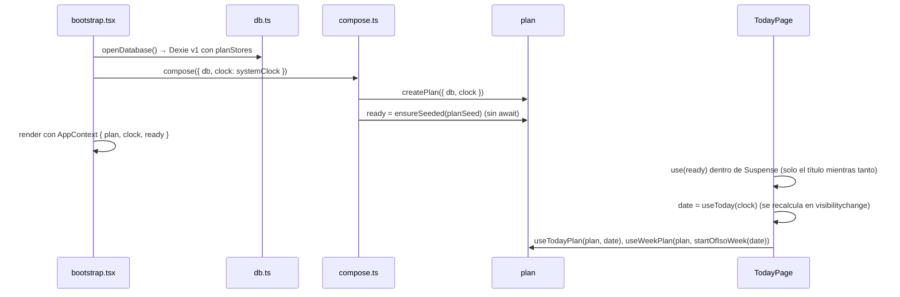

# Plan técnico: Fase 1, plan cargado y "Hoy" con la sesión correcta

**Spec:** `specs/001-fase-1/spec.md` · **Estado:** Aprobado (17-nov-2026) · **Fecha:** 17-nov-2026

## 1. Resumen de la solución

El módulo `plan` gana sus cuatro capas: dominio puro de calendario (`schedule.ts`) y reglas del seed, servicio de aplicación con un repositorio como puerto, repositorio Dexie con esquema Zod del seed, y dos componentes con sus hooks. `app` abre la base Dexie, carga el seed JSON al componer los módulos y expone una promesa `ready`. "Hoy" la espera con `Suspense`, así que nunca muestra el estado vacío ni datos a medias. Los errores de arranque llegan al `ErrorFallback` de la fase 0.

## 2. Módulos afectados

| Módulo | Cambio | ¿Cambia el contrato? |
|---|---|---|
| `plan` | Dominio, aplicación, infraestructura Dexie, esquema Zod del seed, `WeekStrip`, `PlanExerciseList` y hooks | Sí: modules/plan.md §4 (§3 de este plan) |
| `app` | `db.ts`, seed JSON, `compose(deps)` con `ready`, contexto de la app, `useToday`, `TodayPage`, códigos de error de `plan` en `messages.ts` | No (architecture §5.3); se ajusta architecture §7.3 |
| `shared` | Ninguno: se usan `Clock`, `LocalDate`, `Weekday`, `addDays`, `daysBetween`, `startOfIsoWeek`, `weekdayOf` y `Result` tal como están | No |
| `training`, `progression`, `health`, `data` | Ninguno | No |

## 3. Cambios de contrato

Aplicados en modules/plan.md §4 (v1.3) al aprobar este plan, antes de escribir código:

```ts
// Dependencias: solo lo que usa la fase 1. `ids` y `bus` entran con la primera operación que
// los necesite (updateTemplate en v1.0; PlanChanged cuando alguien lo escuche) (P-7).
export function createPlan(deps: { db: Dexie; clock: Clock }): PlanApi;

// Esquema de las tablas propias, para que app/db.ts componga db.version(n).stores({...}).
export const planStores: Record<'exercises' | 'programs' | 'blocks' | 'templates', string>;

export type PlanErrorCode =
  | 'plan/invalid-seed' | 'plan/high-risk-exercise' | 'plan/template-not-found' | 'plan/week-out-of-range';

// Los hooks reciben la API: `ui` no puede leer el contexto de `app` (dependencia al revés).
export function useTodayPlan(plan: PlanApi, date: LocalDate): TodayPlan | undefined;
export function useWeekPlan(plan: PlanApi, weekStart: LocalDate): TodayPlan[] | undefined;

// Componentes
function WeekStrip(props: { days: TodayPlan[]; weekStart: LocalDate; today: LocalDate }): JSX.Element;
function PlanExerciseList(props: { items: PlannedItem[] }): JSX.Element;
```

- `setStartDate`, `jumpToWeek`, `updateTemplate` y `dataPort` siguen en el contrato, pero no se implementan en esta fase (spec 001 §2). Hasta entonces no aparecen en `PlanApi`, para que nadie llame a algo vacío.
- `plan/PlanChanged` no se publica todavía: no hay bus (decisión de la fase 0) ni nadie que lo escuche.

## 4. Datos

- **Dexie, versión 1:** solo las tablas de `plan`, con los índices de modules/plan.md §2 (`exercises: 'id, name, muscleGroup, lumbarRisk'`, `programs: 'id'`, `blocks: 'id, programId'`, `templates: 'id, blockId'`). Sin `upgrade`: es la primera versión.
- Cada módulo añade sus tablas en la versión siguiente cuando llega su fase. Agregar tablas en Dexie no requiere función `upgrade`. architecture §7.3 se ajusta: el esquema que muestra pasa a ser el **objetivo**, y la versión 1 solo trae las tablas de `plan`.
- **Formato de exportación:** sin cambios (el `dataPort` de `plan` llega en la fase 3).
- **Seed:** `src/app/seed/plan-seed.json`. Lo elige `app`, que es la raíz de composición. El módulo lo recibe como `unknown`, así que las pruebas pueden pasarle seeds de ejemplo. Forma:

```ts
interface PlanSeed {
  exercises: Exercise[];
  program: Omit<Program, 'startDate'>;      // RN-PLN-13: la fecha la pone ensureSeeded
  blocks: Block[];
  templates: SessionTemplate[];
}
```

- **IDs:** UUIDv7 generados una vez con `createUuidV7Generator` y escritos en el JSON. Como las referencias por UUID no se leen a simple vista, la prueba de AC-4 traduce cada plantilla a nombres y la compara con un resumen legible (§6.5, §7).

### 4.1 Catálogo del seed (aprobado el 17-nov-2026)

`isPrimary` sigue la propuesta de progression.md §9 (pregunta 7, fase 4), más las alternativas de esos ejercicios. Descansos según plan.md "Reglas generales": compuestos 120-180 s y aislamiento 60-90 s.

| # | Ejercicio | Músculo | Equipo | `metric` | `lumbarRisk` | `isPrimary` | Faja |
|---|---|---|---|---|---|---|---|
| 1 | Prensa de piernas | quads | machine | weight | low | sí | sí |
| 2 | Hack squat | quads | machine | weight | **medium** (carga axial en hombros) | sí | sí |
| 3 | Prensa a una pierna | quads | machine | weight | low | no | |
| 4 | Extensión de cuádriceps | quads | machine | weight | low | no | |
| 5 | Curl femoral | hamstrings | machine | weight | low | no | |
| 6 | Patada de glúteo en polea | glutes | cable | weight | low | no | |
| 7 | Máquina de glúteo | glutes | machine | weight | low | no | |
| 8 | Puente de glúteo | glutes | bodyweight | weight (carga opcional; 0 = sin carga) | **medium** (spec §6.5: hip thrust con carga) | no | |
| 9 | Abducción de cadera en máquina | glutes | machine | weight | low | no | |
| 10 | Elevación de talones | calves | machine | weight | low | no | |
| 11 | Pantorrilla sentado | calves | machine | weight | low | no | |
| 12 | Press de banca con barra | chest | barbell | weight | low | sí | |
| 13 | Press de banca con mancuernas | chest | dumbbell | weight | low | sí | |
| 14 | Press inclinado con mancuernas | chest | dumbbell | weight | low | sí | |
| 15 | Press inclinado en máquina | chest | machine | weight | low | sí | |
| 16 | Aperturas en polea | chest | cable | weight | low | no | |
| 17 | Pec deck | chest | machine | weight | low | no | |
| 18 | Fondos en paralelas | chest | bodyweight | weight (lastre; 0 = peso corporal) | low | no | |
| 19 | Dominadas | back | bodyweight | weight (lastre; 0 = peso corporal) | low | sí | |
| 20 | Jalón al pecho | back | cable | weight | low | sí | |
| 21 | Remo con apoyo de pecho | back | machine | weight | low | sí | |
| 22 | Remo en polea baja | back | cable | weight | **medium** (sin apoyo de pecho) | no | |
| 23 | Pull-over en polea | back | cable | weight | low | no | |
| 24 | Face pull | shoulders | cable | weight | low | no | |
| 25 | Press de hombro con mancuernas | shoulders | dumbbell | weight | low | no | |
| 26 | Press de hombro en máquina | shoulders | machine | weight | low | no | |
| 27 | Elevaciones laterales | shoulders | dumbbell | weight | low | no | |
| 28 | Curl con barra Z | biceps | barbell | weight | low | no | |
| 29 | Curl martillo | biceps | dumbbell | weight | low | no | |
| 30 | Curl en banco inclinado | biceps | dumbbell | weight | low | no | |
| 31 | Extensión de tríceps en polea (cuerda) | triceps | cable | weight | low | no | |
| 32 | Extensión de tríceps sobre la cabeza en polea | triceps | cable | weight | low | no | |
| 33 | Dead bug | core | bodyweight | reps | low | no | |
| 34 | Plancha | core | bodyweight | time | low | no | |
| 35 | Pallof press | core | cable | weight | low | no | |
| 36 | Pallof press isométrico | core | cable | time | low | no | |

Cómo se traducen los "o" y las variantes de plan.md:

| En plan.md | En el seed |
|---|---|
| "Press de banca (barra o mancuernas)" | Principal 12, alternativa 13 |
| "Press inclinado con mancuernas o máquina" | Principal 14, alternativa 15 |
| "Hack squat o prensa con pies bajos" | Principal 2, alternativa 1; nota "Con prensa: pies bajos" |
| "Dominadas (o asistidas / jalón al pecho)" | Principal 19, alternativa 20. "Asistidas" es una forma de hacer la dominada, no otro ejercicio (fase 2) |
| "Dominadas con agarre neutro (o jalón neutro)", "Jalón con agarre neutro" | Los mismos ejercicios 19 y 20, con la nota "Agarre neutro" |
| "Remo en polea baja (agarre neutro)", "Remo con pecho apoyado (agarre distinto al martes)", "Prensa de piernas (pies altos o separados)" | Los ejercicios 22, 21 y 1, con esa indicación en la nota de la plantilla |
| "Patada de glúteo en polea o máquina de glúteo", "Máquina de glúteo o puente de glúteo" | 6 con alternativa 7; 7 con alternativa 8 |
| "Aperturas en polea o pec deck", "Pull-over en polea o face pull" | 16 con alternativa 17; 23 con alternativa 24 |
| "Plancha o pallof press" (30-45 s) | Principal 34, alternativa 36 (misma métrica, RN-PLN-11) |
| "8-10 por lado", "10-12 por pierna" | Rango de reps en `reps` y "Por lado" o "Por pierna" en la nota |

### 4.2 Bloques

| Bloque (nombre visible) | Semanas | `targetRir` | `weekRir` | `weekFactors` | Calendario |
|---|---|---|---|---|---|
| Bloque 1 · Full body | 1-4 | [2, 3] | {1: [3, 4]} | {1: 0.7} | L/X/V con `weekParity` (A/B/A impar, B/A/B par); M cardio suave, S cardio moderado; J y D descanso |
| Bloque 2 · Torso/Pierna | 5-8 | [2, 3] | {5: [3, 3]} | {5: 0.7} | L Torso A, M Pierna A, X cardio suave, J Torso B, V Pierna B, S cardio moderado, D descanso |
| Bloque 3 · PPL + Upper/Lower | 9-14 | [1, 3] | {9: [3, 3]} | {9: 0.7} | L Push, M Pull, X Legs, J cardio muy suave, V Upper, S Lower, D "Cardio moderado o descanso" |
| Descarga | 15 | [4, 4] | — | — (RN-PLN-04: 0.5) | El del bloque 3, con sus plantillas (RN-PLN-12) |

El nombre visible del bloque va en `Block.name`, así que el encabezado de "Hoy" no necesita calcular el número de bloque.

## 5. Flujo



- `ensureSeeded`: el esquema Zod (infraestructura, ADR-0007) valida la forma, las reglas puras de `domain/seed-rules.ts` validan RN-PLN-07, 11 y 15, y el repositorio escribe todo en una transacción `rw` sobre las 4 tablas solo si `programs` está vacía (RN-PLN-14). IndexedDB serializa las transacciones `rw` sobre las mismas tablas, también entre pestañas: la segunda ve el programa y no escribe.
- `ready` rechaza con un `Error` si `ensureSeeded` devuelve `err` o si la base no abre. `use(ready)` lanza en el render y lo captura el `errorElement` de la ruta raíz (`ErrorFallback` con "Recargar", AC-21). Así no hay un aviso no bloqueante encima de una pantalla a medias.
- `AppContext` (en `app/context.tsx`) es inyección de dependencias, no estado: el valor nunca cambia. No contradice ADR-0006 (Zustand para estado efímero).

## 6. Decisiones

### 6.1 Versiones (npm, 17-nov-2026)

| Paquete | Versión | Tipo | Motivo |
|---|---|---|---|
| `dexie` | 4.4.7 | dependencia | ADR-0002 |
| `dexie-react-hooks` | 4.4.0 | dependencia | `useLiveQuery` (architecture §7.3); peer `dexie >=4.2 <5`, `react >=16` |
| `zod` | 4.6.7 | dependencia | ADR-0007 (todavía no estaba instalado) |
| `fake-indexeddb` | 6.2.8 | desarrollo | Pruebas de integración con IndexedDB en Node (QS-04, QS-08) |

En la tarea de instalación se revisa que ninguno ejecute scripts de instalación (`allowScripts`) y se corre `npm audit`.

### 6.2 Zod clásico, no `zod/mini`

ADR-0007 permite `zod/mini` si el tamaño importa. Se empieza con el clásico, que tiene mejor API y mejores mensajes, y se mide con `size-limit` al integrarlo. Si el JS inicial pasa de 170 KB, se cambia a `zod/mini`; solo afecta a `infrastructure/seed-schema.ts`.

### 6.3 Hooks en `ui`, no en `application`

architecture §5.2 pone los hooks en `application`, pero esa capa no puede importar Dexie, y `useLiveQuery` sí lo necesita. Los hooks viven en `plan/ui/hooks.ts` y llaman a la API pública. Contra QS-09 (cambiar Dexie por HTTP), el coste es que también cambiarían los hooks, no solo `infrastructure`. Se acepta y se corrige architecture §5.2. La alternativa (un puerto observable propio con `useSyncExternalStore`) añade código sin uso en la v1 (P-7).

### 6.4 `useLiveQuery` solo con operaciones Dexie dentro

La consulta que observa `useLiveQuery` solo debe esperar promesas de Dexie: una promesa ajena (por ejemplo, un `setTimeout`) rompe el seguimiento de las tablas. El servicio de aplicación no espera nada más que el repositorio, y una prueba de integración comprueba que el hook se actualiza tras escribir en la tabla.

### 6.5 Seed en JSON escrito a mano, verificado por pruebas

Se descartó generar el JSON leyendo `docs/plan.md` con un script: el Markdown no es un formato estable y el script sería más código que el propio seed. Lo protegen la validación (AC-4, AC-5) y un resumen legible del seed que la prueba compara, plantilla por plantilla, con lo que dice plan.md.

### 6.6 `startDate` y los días de la semana

`Weekday` del kernel usa `0 = domingo` (como `Date.getDay`). El JSON usa esos números y el resumen legible los muestra como nombres, para detectar un domingo mal puesto. `startOfIsoWeek(clock.today())` da el lunes (RN-PLN-10, 13).

### 6.7 Fecha de "Hoy"

`useToday(clock)` en `app/hooks/` lee `clock.today()` al montar y en cada `visibilitychange` a `visible` (AC-20). Las fechas visibles se formatean con `Intl.DateTimeFormat('es', { weekday: 'long', day: 'numeric', month: 'long', timeZone: 'UTC' })` sobre la `LocalDate` a medianoche UTC, igual que el kernel (ADR-0009).

### 6.8 Errores

`messages.ts` incluye `PlanErrorCode` en `ErrorCode`. Los cuatro mensajes son el genérico (spec 001 §6) y se quita el `eslint-disable` justificado de la fase 0, porque el mapa ya no está vacío.

## 7. Estrategia de pruebas

Las pruebas del dominio y de `ensureSeeded` se escriben antes que el código, citando su regla (P-5).

| Criterio | Tipo de prueba | Archivo |
|---|---|---|
| AC-1 | Integración (`fake-indexeddb`, `fixedClock`) + E2E con `page.clock` | `src/modules/plan/__tests__/ensure-seeded.test.ts`, `tests/e2e/today.spec.ts` |
| AC-2, AC-3 | Integración (`fake-indexeddb`) | `src/modules/plan/__tests__/ensure-seeded.test.ts` |
| AC-4 | Unitaria sobre el seed real + resumen legible | `src/app/seed/__tests__/plan-seed.test.ts` |
| AC-5, AC-6 | Unitaria (reglas) + integración (base vacía tras el error) | `src/modules/plan/__tests__/seed-rules.test.ts`, `ensure-seeded.test.ts` |
| AC-7 | E2E sin conexión | `tests/e2e/today.spec.ts` |
| AC-8 a AC-14 | Unitaria del dominio con datos pequeños (por regla) + integración con el seed real (por criterio) | `src/modules/plan/__tests__/schedule.test.ts`, `src/app/seed/__tests__/plan-seed.test.ts` |
| AC-15 a AC-19 | Componente (`TodayPage` con `createPlan`, `fake-indexeddb` y `fixedClock`) | `src/app/__tests__/today-page.test.tsx` |
| AC-20 | Componente: cambia el reloj y dispara `visibilitychange` | `src/app/__tests__/today-page.test.tsx` |
| AC-21 | Componente: seed inválido y base que no abre | `src/app/__tests__/today-page.test.tsx` |
| AC-22 | E2E + axe en día de pesas y de descanso | `tests/e2e/a11y.spec.ts` |
| AC-23 | `size-limit` en CI | `.size-limit.json` |
| §6.4 | Integración: el hook se actualiza tras escribir en la tabla | `src/modules/plan/__tests__/hooks.test.tsx` |

- `fake-indexeddb` se importa en cada archivo que lo usa (`import 'fake-indexeddb/auto'`), no en la configuración global, y cada prueba usa una base con nombre propio.
- Cobertura: el umbral de 80% ya incluye `src/modules/*/domain/**` (RNF-08).
- Mutaciones (handoff): tras cada prueba en verde, romper la regla a propósito y ver que falla la prueba correcta.

## 8. Riesgos

| Riesgo | Mitigación |
|---|---|
| El JSON escrito a mano tiene un error que no rompe la validación (un día cambiado, unas reps mal copiadas) | El resumen legible de AC-4 se compara con plan.md; el usuario lo revisa en el PR |
| `useLiveQuery` deja de reaccionar si la consulta espera una promesa ajena a Dexie | §6.4 y su prueba |
| `fake-indexeddb` no se comporta igual que Safari | Los E2E corren en WebKit; verificación manual en el iPhone al final, como T26 |
| El bundle crece de más con Dexie y Zod | Medición con `size-limit` en la tarea de integración; si hace falta, `zod/mini` (§6.2) |
| `page.clock` de Playwright con el service worker | El reloj se instala antes de navegar; si da problemas, AC-1 en E2E se limita a "se ve una sesión" y la fecha exacta queda en la prueba de componente |
| Safari borra el almacenamiento y el plan vuelve a empezar en la semana 1 | Aceptado en spec 001 §7; RF-03 y la exportación lo resuelven en fases siguientes |
| `npm audit` (17-nov-2026, T1): 28 altas por un solo aviso, `picomatch` ≤ 4.0.7 (ReDoS con *extglobs*, GHSA-fc5q-39xc-vjpf), vía Vite, Vitest, ESLint, stylelint, dependency-cruiser y vite-plugin-pwa; más las 2 moderadas de `glob`/`minimatch` de la fase 0. No existe versión corregida (4.0.7 es la última) y ninguno viene de las dependencias nuevas | Solo herramientas de build, lint y pruebas, con patrones propios; no llega al bundle. No se aplica `npm audit fix --force` (baja versiones mayores). Revisar en cada actualización: cuando salga `picomatch` > 4.0.7, subirlo |

## 9. Checklist de la constitución

- [x] **P-1:** las reglas del seed rechazan `high` en plantillas y alternativas; el catálogo propuesto no tiene ningún `high`.
- [x] **P-2:** carga atómica e idempotente en una transacción; primera versión del esquema sin migraciones.
- [x] **P-3:** contrato v1.3 y architecture §5.2 y §7.3 actualizados antes del código; catálogo aprobado por el usuario.
- [x] **P-4:** `app` usa solo `@/modules/plan`; solo `plan` toca sus tablas; los hooks reciben la API, no leen el contexto de `app`.
- [x] **P-5:** `schedule.ts` y `seed-rules.ts` son puros; pruebas primero.
- [x] **P-6:** axe y `size-limit` (AC-22, AC-23).
- [x] **P-7:** sin bus, `ids`, `dataPort` ni puerto observable propio; seed en JSON sin generador.
- [x] **P-8:** Zod en la frontera del seed; `PlanErrorCode` tipado; sin `any`.
