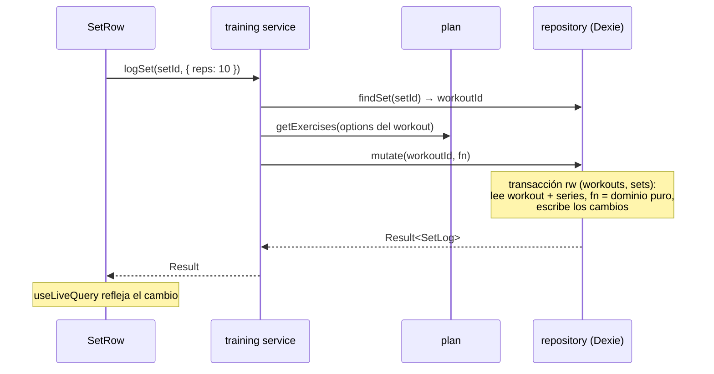

# Plan técnico: Fase 2, sesión activa

**Spec:** `specs/002-fase-2/spec.md` · **Estado:** Aprobado · **Fecha:** 17-nov-2026

## 1. Resumen de la solución

El módulo `training` gana sus cuatro capas. El dominio son funciones puras que reciben el estado de un workout y devuelven los cambios (RN-TRN-*). El servicio de aplicación lee de `plan` lo que necesita antes de abrir la transacción, y el repositorio Dexie aplica cada cambio en una transacción que vuelve a leer el workout, llama al dominio y escribe (RN-TRN-01, 03, 11, 13). La UI se compone de `SetRow`, `SetTable` y `SessionHeader`, con hooks que reciben la API. `app` sube la base a la versión 2, añade `training` al contexto y completa "Hoy", la vista previa de otro día y la página de sesión. No hay bus de eventos ni estado en Zustand en esta fase.

## 2. Módulos afectados

| Módulo | Cambio | ¿Cambia el contrato? |
|---|---|---|
| `training` | Dominio, aplicación, infraestructura Dexie, hooks, `SetRow`, `SetTable`, `SessionHeader` | Sí: modules/training.md §4 → v1.3 (§3 de este plan) |
| `plan` | `PlannedItem.alternatives`, `getExercise(s)`, RN-PLN-15 (i) | Ya en v1.11 (spec 002); sin cambios nuevos |
| `shared` | `ConfirmDialog` en `shared/ui` (modules/shared.md §4, ya previsto) | No |
| `app` | `db.ts` v2, `compose` con `training` y `SuggestionProvider` nulo, contexto, `TodayPage`, `DayPreviewPage`, `SessionPage`, mensajes de error, `UpdatePrompt` | No (architecture §5.3); se añade la ruta `/dia/:date` a architecture §7 y spec §7.2 |
| `progression`, `health`, `data` | Ninguno | No |

## 3. Cambios de contrato

Aplicados en modules/training.md §4 (v1.3) al aprobar este plan, antes de escribir código:

```ts
// Sin configureTraining: los puertos entran como dependencias. El ciclo con progression (fase 4)
// lo resuelve compose con un proveedor que delega en una variable asignada después (§6.2).
export function createTraining(deps: {
  db: Dexie; clock: Clock; ids: IdGenerator;
  plan: Pick<PlanApi, 'getTodayPlan' | 'getExercises'>;
  suggestions: SuggestionProvider;
}): TrainingApi;                       // painGate entra con finishWorkout (fase 3)

export const trainingStores: Record<'workouts' | 'sets', string>;

export type TrainingErrorCode =
  | 'training/workout-not-found' | 'training/workout-already-active' | 'training/workout-closed'
  | 'training/set-not-found' | 'training/invalid-set-values' | 'training/no-plan-today'
  | 'training/planned-date-out-of-week' | 'training/max-sets-reached' | 'training/set-not-removable'
  | 'training/invalid-exercise-choice' | 'training/item-has-done-sets';
  // 'training/pain-required' entra con finishWorkout (fase 3)

// details de training/invalid-set-values, para que app elija el texto (§6.6)
interface InvalidSetValuesDetails {
  field: 'weightKg' | 'reps' | 'rir';
  reason: 'missing' | 'not-a-number' | 'out-of-range' | 'step' | 'not-allowed';
}

// details de training/workout-already-active
interface WorkoutAlreadyActiveDetails { workoutId: ID }

// Lo que necesita la página de sesión, en una sola consulta reactiva (§6.4)
interface WorkoutView {
  workout: Workout;
  sets: SetLog[];                        // por ítem y setNumber
  exercises: Record<ID, Exercise>;       // todas las options de todos los ítems
}

interface TrainingApi {                  // fase 2
  startWorkout(date: LocalDate, opts?: { plannedFor?: LocalDate }): Promise<Result<Workout>>;
  logSet(setId: ID, input: { weightKg?: number | null; reps?: number | null; rir?: number | null }): Promise<Result<SetLog>>;
  toggleSetDone(setId: ID): Promise<Result<SetLog>>;
  addExtraSet(workoutId: ID, exerciseId: ID): Promise<Result<SetLog>>;
  removeSet(setId: ID): Promise<Result<void>>;
  chooseExercise(workoutId: ID, fromExerciseId: ID, toExerciseId: ID): Promise<Result<Workout>>;
  discardWorkout(workoutId: ID): Promise<Result<void>>;
  getActiveWorkout(): Promise<Workout | undefined>;
  getWorkout(id: ID): Promise<Workout | undefined>;
  getWorkoutView(id: ID): Promise<WorkoutView | undefined>;
  getExerciseHistory(exerciseId: ID, opts?: { limit?: number; before?: LocalDate }): Promise<ExerciseSession[]>;
}

// Hooks: reciben la API, como los de plan (RN-PLN-26). null = no existe; undefined = cargando.
export function useWorkoutView(training: TrainingApi, id: ID): WorkoutView | null | undefined;
export function useActiveWorkout(training: TrainingApi): Workout | null | undefined;
export function useLastSession(training: TrainingApi, exerciseId: ID, before: LocalDate): ExerciseSession | null | undefined;

// Componentes
function SetTable(props: {
  training: TrainingApi; view: WorkoutView; exerciseId: ID;
  describeError: (error: DomainError) => string;   // textos desde app (ADR-0010)
}): JSX.Element;
function SetRow(props: { /* una serie; la usa SetTable */ }): JSX.Element;
function SessionHeader(props: { view: WorkoutView; index: number; onNavigate: (index: number) => void }): JSX.Element;
```

- `useWorkout(id)` del contrato pasa a ser `useWorkoutView(training, id)`. `getWorkoutSummary`, `listWorkouts`, `getWorkoutExerciseIds`, `finishWorkout` y `dataPort` siguen en el contrato, pero no entran en `TrainingApi` hasta la fase 3 (como hizo `plan` en la fase 1).
- `getWorkoutView` lee las tablas de `training` y llama a `plan.getExercises`. Las dos lecturas pasan por Dexie, así que `useLiveQuery` sigue a las dos (§6.4).

## 4. Datos

- **Dexie, versión 2:** `db.version(2).stores({ ...planStores, ...trainingStores })`, y se mantiene `db.version(1)` tal como está. Agregar tablas no requiere `upgrade`. `trainingStores`:
  - `workouts: 'id, date, status, templateId'`: `status` para `getActiveWorkout`, y `date` para el historial.
  - `sets: 'id, workoutId, exerciseId, [exerciseId+completedAt]'`: `workoutId` para la vista y `exerciseId` para "anterior".
- **Qué se guarda:** objetos del dominio tal cual (`Workout` con `items`, `SetLog`), como RN-PLN-25. `done` no se indexa (IndexedDB no indexa booleanos).
- **Subida desde v1 (AC-38):** una prueba crea una base v1 con el plan cargado y la abre con `openDatabase`: el plan y `startDate` siguen ahí y las tablas nuevas existen vacías. En el iPhone se verifica a mano en la tarea de cierre.
- **Exportación:** sin cambios (el `dataPort` de `training` llega en la fase 3).

## 5. Flujo



- **Patrón de escritura:** el servicio reúne antes de la transacción todo lo asíncrono que no es de `training` (ejercicios de `plan`, prellenado del `SuggestionProvider`, `clock.now()`), porque una transacción de Dexie no puede esperar promesas ajenas y no hay transacciones entre módulos (architecture §7.3). Dentro, `mutate` vuelve a leer el workout y sus series, llama a una función pura del dominio y escribe lo que devuelva. Así, dos pestañas no se pisan y RN-TRN-01 (activo único) y RN-TRN-07 (cerrado) se comprueban sobre el estado que se va a escribir.
- **`startWorkout`:** `plan.getTodayPlan(plannedFor)` y el prellenado de cada ejercicio, y después `createIfNoneActive(workout, sets)` en una transacción que busca un `in_progress` antes de insertar.
- **Fuera de la transacción:** cualquier error del dominio se devuelve como `Result` y la transacción no escribe. Un fallo de Dexie rechaza la promesa (como RN-PLN-21).

## 6. Decisiones

### 6.1 Capas de `training`

```
training/
  index.ts                createTraining, trainingStores, hooks, componentes, tipos
  domain/types.ts         Workout, WorkoutItem, SetLog, WorkoutView, TrainingErrorCode
  domain/set-values.ts    RN-TRN-04: parse y validación por métrica y equipo
  domain/workout.ts       RN-TRN-02, 12, 14 (crear) y 05, 07, 10, 11, 13, 15 (cambios)
  application/ports.ts    TrainingRepository, SuggestionProvider, PlanReader
  application/service.ts  createTrainingService
  infrastructure/schema.ts, dexie-repository.ts
  ui/hooks.ts, format.ts, SetRow.tsx, SetTable.tsx, SessionHeader.tsx (+ .module.css)
```

Las funciones de `domain/workout.ts` reciben el estado (`{ workout, sets }`), los ejercicios y `now`, y devuelven `Result<{ changes, value }>`. `changes` dice qué series poner o borrar y si el workout cambia. Se prueban sin Dexie (P-5, QS-08) y el servicio, con un repositorio en memoria que implementa `mutate` igual que el de Dexie.

```ts
// application/ports.ts
interface TrainingRepository {
  findSet(setId: ID): Promise<SetLog | undefined>;
  load(workoutId: ID): Promise<{ workout: Workout; sets: SetLog[] } | undefined>;
  findActive(): Promise<Workout | undefined>;
  createIfNoneActive(workout: Workout, sets: SetLog[]): Promise<{ created: true } | { created: false; activeId: ID }>;
  mutate<T>(workoutId: ID, fn: (state: WorkoutState) => Result<{ changes: WorkoutChanges; value: T }>): Promise<Result<T>>;
  history(exerciseId: ID, opts: { limit?: number; before?: LocalDate }): Promise<ExerciseSession[]>;
}
```

### 6.2 Puertos como dependencias, sin `configureTraining`

El contrato tenía `configureTraining(ports)` para romper el ciclo `training` ↔ `progression`: estado global del módulo, que obliga a reiniciarlo entre pruebas. En su lugar, `createTraining` recibe `suggestions`. En la fase 2, `compose` pasa `nullSuggestions` (siempre `null`). En la fase 4, pasa `{ getPrefill: (id) => progression.getPrefill(id) }`, con `progression` asignada después de crear `training`. El cierre del objeto evita el ciclo al crear los módulos.

### 6.3 Sin bus ni Zustand en esta fase

- **Bus:** nadie escucha (spec 002 §5). `compose` sigue sin crearlo.
- **Zustand (ADR-0006, architecture §7.8):** el ejercicio actual vive en la URL (`:exerciseIndex`) y lo demás es local. El borrador de cada campo vive en `useState` de `SetRow`, el interruptor "Con asistencia" en `SetTable` y la lista "Ver ejercicios" en `SessionHeader`. `useSessionStore` entra con el temporizador (fase 4), que sí necesita sobrevivir a la navegación.

### 6.4 Una consulta reactiva por pantalla

`useWorkoutView` envuelve `getWorkoutView` en `useLiveQuery` con el patrón fechado de `plan` (la clave es el `id`, RN-PLN-26). Como la consulta lee las series y los ejercicios, cualquier cambio en las tablas `workouts`, `sets` o `exercises` vuelve a renderizar la página. `useLastSession` es aparte, una por ejercicio visible, con la clave `exerciseId + before`; `before` es la `date` del workout, así que se excluye la sesión actual. Medición (AC-21): con 7 ejercicios y unas 25 series, una escritura más la consulta deberían tardar pocos ms. Si la traza pasa de 100 ms, `SetRow` muestra el check de forma optimista hasta que llegue la consulta.

### 6.5 Entrada de números

- `<input type="text" inputmode="decimal">` para kg e `inputmode="numeric"` para reps y RIR, no `type="number"`, que en Safari acepta letras y pierde el valor con coma. El teclado de iOS en español muestra **coma**: `parseNumber` en `training/domain/set-values.ts` acepta "62,5" y "62.5", y vacío es `null`. Un texto que no es número llega al dominio como `NaN` y vuelve como `invalid-set-values` con `reason: 'not-a-number'` (un solo camino de validación).
- El valor se envía en `change` (al salir del campo o al cerrar el teclado), no en cada tecla. El campo conserva lo escrito mientras haya error, y lo guardado no cambia (spec 002 §6).
- Con "Con asistencia", el campo muestra y acepta el valor absoluto, y `SetTable` lo envía en negativo.

### 6.6 Mensajes de error (ADR-0010)

- `app/errors/messages.ts` añade `TrainingErrorCode` a `ErrorCode` con sus textos, y un segundo mapa, `setValueMessages: Record<field, Record<reason, string>>`, para `invalid-set-values`. El rango del texto depende de la métrica y de si hay asistencia, así que es una función pequeña en `app`, con sus pruebas.
- `SetTable` recibe `describeError` y no tiene ningún texto de error propio. Los textos de interfaz que no son errores ("Añadir serie", "Asistencia 20 kg") sí viven en `training/ui`, como los de `plan/ui`.
- `workout-already-active` al iniciar (carrera con otra pestaña) no muestra error: navega a la sesión activa.

### 6.7 Rutas y páginas

| Ruta | Página | Notas |
|---|---|---|
| `/` | `TodayPage` | Con `useActiveWorkout`: "Continuar sesión" (con fecha si es de otro día) y "Descartar sesión"; si no, "Iniciar sesión" en días de pesas y la sección "Otra sesión de esta semana" |
| `/dia/:date` (nueva, dentro de `AppLayout`) | `DayPreviewPage` | Vista previa de otro día de la semana con `PlanExerciseList` e "Iniciar sesión". Si la fecha no es válida, es de otra semana, es hoy o no es día de pesas, redirige a `/` con `replace` |
| `/sesion/:workoutId/:exerciseIndex` | `SessionPage` | `exerciseIndex` empieza en 1. Si no es un entero de 1 a n, redirige con `replace` al primer ejercicio con series pendientes (o al último si no hay pendientes). Un workout inexistente o cerrado muestra "Esta sesión ya no está disponible." (AC-28) |

- `AppServices` gana `training`. `TodayPage` y `DayPreviewPage` comparten un componente `StartWorkoutButton` en `app/pages`.
- **"Ver ejercicios"** es una lista desplegable dentro de `SessionHeader` (`<button aria-expanded>` y `<ol>`), no un diálogo. Cada fila es un enlace al ejercicio con su avance ("1 de 2 series"), y al final está "Descartar sesión".
- **`ConfirmDialog`** en `shared/ui`: `<dialog>` nativo con `showModal()` (el resto de la página queda inerte y Escape cancela), y el foco vuelve al botón que lo abrió. Si jsdom no implementa `showModal`, se añade un relleno mínimo solo en la configuración de las pruebas; el comportamiento real lo cubre el E2E en Chromium y WebKit.

### 6.8 Aviso de actualización aplazado (AC-37)

`UpdatePrompt` lee `useActiveWorkout(training)` y no muestra nada mientras haya una sesión activa. `needRefresh` sigue en `true`, así que el aviso aparece solo al descartar (o, en la fase 3, al cerrar). Como vive fuera del router, recibe `training` por `AppContext`.

### 6.9 Presupuesto del bundle

Estamos en 168.64 kB de 200 kB y el umbral para cambiar a `zod/mini` es 170 kB (plan 001 §6.2). `training` no usa Zod, pero la sesión activa añade código propio y lo más probable es que se pase del umbral. Se mide al terminar el punto de control C (la UI). Si pasa de 170 kB, se cambia `plan/infrastructure/seed-schema.ts` a `zod/mini` en su propia tarea, con las pruebas del esquema sin cambios. No se dividen rutas con `lazy`, porque `.size-limit.json` mide todos los JS de `dist/assets` y la PWA los precachea igual.

### 6.10 Prellenado y "anterior"

- `nullSuggestions` vive en `app/compose.ts`, no en `training` (es cableado, no regla).
- La columna "anterior" de la serie `n` es la serie `n` de la última sesión `completed` del ejercicio (RN-TRN-08); "—" si no hay. En la fase 2 siempre es "—" en uso real (no hay cierre), y sus pruebas insertan un workout `completed` con el repositorio.

## 7. Estrategia de pruebas

Las reglas RN-TRN-* se escriben con pruebas primero en el dominio (P-5), aunque `training` no está en la lista obligatoria de la constitución (solo `progression` y `health`): son la ruta crítica de P-2.

| Criterio | Tipo de prueba | Archivo |
|---|---|---|
| RN-TRN-04 (AC-16 a AC-19b) | Unitaria (dominio) | `src/modules/training/__tests__/set-values.test.ts` |
| RN-TRN-02, 05, 07, 10 a 15 (AC-1, 8, 10, 13 a 15, 20, 23, 24, 31 a 35) | Unitaria (dominio) | `src/modules/training/__tests__/workout.test.ts` |
| AC-1 a AC-3, 6, 8, 10, 29, 30 | Unitaria del servicio con repositorio en memoria y un `PlanReader` falso (QS-08) | `src/modules/training/__tests__/training-service.test.ts` |
| AC-41 (P-1) | Integración: `createPlan` y `createTraining` sobre el seed real; cada plantilla y cada alternativa. Vive en `app` porque `training` no puede importar el seed ni los fixtures de `plan` (fronteras) | `src/app/seed/__tests__/training-safety.test.ts` |
| AC-2 (concurrencia), AC-4, AC-12, RN-TRN-03 | Integración (`fake-indexeddb`): dos instancias sobre la misma base, recarga | `src/modules/training/__tests__/dexie-repository.test.ts` |
| Hooks (§6.4) | Integración: la vista se actualiza al escribir en `sets` | `src/modules/training/__tests__/hooks.test.tsx` |
| `SetRow`, `SetTable`, `SessionHeader` (AC-17, 19b, 22, 24 a 26, 31, 33) | Componente, por rol y nombre accesible | `src/modules/training/__tests__/components.test.tsx` |
| `PlannedItem.alternatives`, `getExercise(s)`, RN-PLN-15 (i) | Unitaria e integración de `plan` | `schedule.test.ts`, `plan-service.test.ts`, `seed-rules.test.ts` |
| AC-38 | Integración: base v1 → v2 | `src/app/__tests__/db.test.ts` |
| AC-3, 5, 7, 9, 11 | Componente (`TodayPage` con relojes fijos) | `src/app/__tests__/today-page.test.tsx` |
| AC-8 (vista previa), rutas inválidas de `/dia` | Componente | `src/app/__tests__/day-preview-page.test.tsx` |
| AC-22 a AC-28, AC-34 | Componente (`SessionPage`) | `src/app/__tests__/session-page.test.tsx` |
| Mensajes (§6.6) | Unitaria | `src/app/errors/__tests__/messages.test.ts` |
| AC-37 | Componente con `useRegisterSW` simulado | `src/app/__tests__/update-prompt.test.tsx` |
| `ConfirmDialog` | Componente | `src/shared/ui/__tests__/confirm-dialog.test.tsx` |
| AC-4 y AC-36 (recarga, sin conexión), AC-21 (traza), AC-39 (axe) | E2E en Chromium y WebKit | `tests/e2e/session.spec.ts`, `tests/e2e/a11y.spec.ts` |
| AC-40 | `size-limit` en CI | `.size-limit.json` |

- **AC-21:** el E2E toca el check y mide hasta el cambio de `aria-checked` con un `MutationObserver` en la página. El umbral es 100 ms en Chromium; en WebKit solo se registra, porque el tiempo en CI varía. La medición en el iPhone va en la tarea de cierre.
- **Mutaciones** (handoff): tras cada prueba en verde, romper la regla y ver que falla la prueba de esa regla.

## 8. Riesgos

| Riesgo | Mitigación |
|---|---|
| El bundle pasa de 170 kB | `zod/mini` en su propia tarea (§6.9) |
| Una transacción de Dexie que espera una promesa ajena se cierra a mitad (`TransactionInactiveError`) | Todo lo asíncrono ajeno se reúne antes de `mutate` (§5); `fn` es síncrona por tipo; una prueba de integración cubre cada operación |
| `fake-indexeddb` no reproduce la serialización de transacciones entre pestañas de Safari | AC-2 en integración con dos conexiones y E2E en WebKit con dos páginas |
| La respuesta pasa de 100 ms en el iPhone | Medición en la tarea de cierre; check optimista (§6.4) |
| jsdom sin `showModal` | Relleno en las pruebas; E2E real (§6.7) |
| Safari borra la sesión activa (sin `persist()`) | Aceptado (spec 002 §7); la exportación llega en la fase 3 |

## 9. Checklist de la constitución

- [x] **P-1:** `training` solo usa ejercicios del plan validado; AC-41 recorre todas las plantillas y alternativas.
- [x] **P-2:** cada cambio es una transacción que se confirma antes de devolver; descartar no borra nada; subida v1 → v2 probada (AC-38).
- [x] **P-3:** contrato `training` v1.3 actualizado antes del código; ruta `/dia/:date` añadida a spec §7.2 y architecture.
- [x] **P-4:** `training` usa solo `@/modules/plan`; `app` usa solo los `index.ts`; nadie toca tablas ajenas.
- [x] **P-5:** dominio puro con `now` y los ejercicios como parámetros; pruebas primero.
- [x] **P-6:** AC-21, AC-39 y AC-40.
- [x] **P-7:** sin bus, Zustand, `configureTraining` ni `lazy`; diálogo nativo.
- [x] **P-8:** `TrainingErrorCode` tipado; sin entradas externas nuevas; sin `any`.
