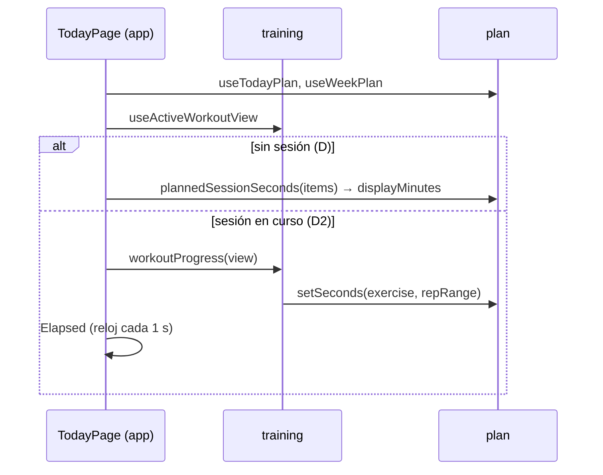

# Plan técnico: Rediseño de "Hoy"

**Spec:** `specs/003-rediseno-hoy/spec.md` · **Estado:** Aprobado (18-nov-2026)

## 1. Resumen de la solución

Sin tablas nuevas. `plan` añade la estimación de duración (RN-PLN-27) como funciones puras exportadas. `training` añade el avance y el tiempo restante de la sesión en curso (RN-TRN-20 y 21): el cálculo vive en su dominio, y `application` le pasa el tiempo por serie de `plan`. También añade una consulta reactiva del `WorkoutView` activo. "Hoy" se reparte en componentes pequeños dentro de `app/pages`. `WeekStrip`, `PlanExerciseList` y `ConfirmDialog` cambian en su módulo.

## 2. Módulos afectados

| Módulo | Cambio | ¿Cambia el contrato? |
|---|---|---|
| `plan` | `domain/duration.ts` (RN-PLN-27) exportado por `index.ts`; `WeekStrip` con marcas nuevas; `PlanExerciseList` sin RIR por ejercicio | Sí: `modules/plan.md` §4 y §5 (v1.14) |
| `training` | `domain/progress.ts` (RN-TRN-20 y 21); `getActiveWorkoutView` y `useActiveWorkoutView`; `workoutProgress` exportado | Sí: `modules/training.md` §4 (v1.16) |
| `shared` | `ConfirmDialog` anclado abajo (hoja inferior) | Sí: `modules/shared.md` §4 |
| `app` | `TodayPage` en componentes; reloj por segundo; textos de descarte con cuentas; "Empezar sesión"; `SessionPage` usa `workoutProgress`; `DayPreviewPage` muestra el RIR una vez bajo el título | No (no es un módulo) |

## 3. Cambios de contrato

Se escriben en `modules/*.md` al aprobar este plan, antes del código.

**`plan` v1.14 (§4, API pública):**

```ts
// domain/duration.ts (RN-PLN-27), reexportado por index.ts
export const WARMUP_SECONDS = 600;
export const SET_WORK_SECONDS = 45;
export const EXERCISE_CHANGE_SECONDS = 90;
/** Segundos de una serie: trabajo (45 s, o la media de repRange si metric = 'time') + descanso medio. */
export function setSeconds(exercise: Pick<Exercise, 'metric' | 'restSeconds'>, repRange: [number, number]): number;
/** RN-PLN-27 completa: calentamiento + Σ (plannedSets × setSeconds + cambio). */
export function plannedSessionSeconds(items: PlannedItem[]): number;
/** Minutos que se muestran: múltiplo de 5 más cercano (Math.round), mínimo 5. */
export function displayMinutes(seconds: number): number;
```

- `index.ts` también exporta `formatRir` ("RIR 3-4"), que ya existe en `ui/format.ts`.
- `TodayPlan` no cambia: la duración se calcula en la página con `plannedSessionSeconds(today.plannedItems)`, sin tocar el servicio ni los hooks.
- `PlanExerciseList({ items })`: cada fila muestra el nombre, "series × reps" y la nota. Ya no muestra "RIR" por ejercicio, porque es el mismo para todos (RN-PLN-06) y va una sola vez: en el chip de "Hoy" y en la vista previa de `/dia/:date`, en una línea bajo el `h2` de la sesión ("RIR 3-4", decisión 6.11).
- `WeekStrip({ days, weekStart, today })`: misma firma. Las marcas dependen de `day.kind` y de si la fecha es pasada, hoy o futura (spec §6.4). El estado "hecha" no entra hasta la fase 3 (P-7). Entonces la firma ganará un `done` por día que calcula `app`.

**`training` v1.16 (§4, API pública):**

```ts
interface TrainingApi {
  // ...
  getActiveWorkoutView(): Promise<WorkoutView | undefined>; // RN-TRN-01 elige el activo; RN-TRN-17 arma la vista
}
export function useActiveWorkoutView(training: TrainingApi): WorkoutView | null | undefined; // RN-TRN-19

interface WorkoutProgress {
  itemsDone: number;                    // RN-TRN-21
  itemCount: number;
  items: ('done' | 'current' | 'pending')[];  // un estado por ítem, para la barra de segmentos
  current: { itemIndex: number; exerciseId: ID; setNumber: number } | null; // itemIndex desde 1, como la ruta
  remainingSeconds: number | null;      // RN-TRN-20; null sin series pendientes
  setsDone: number;                     // para el texto de descarte
  itemsWithDoneSets: number;
}
export function workoutProgress(view: WorkoutView): WorkoutProgress;
```

- `domain/progress.ts` exporta `progressOf(state, setSeconds, changeSeconds)`. Recibe el tiempo por serie como función (`(exerciseId) => number`), así el dominio no importa `plan`, porque solo `application` puede hacerlo (architecture §5.2).
- `application/progress.ts` exporta `workoutProgress(view)`: arma esa función con `setSeconds` de `plan`, los `restSeconds` y `metric` de `view.exercises` y el `repRange` del ítem. Es lo que exporta `index.ts`.
- `useActiveWorkout` se queda: lo usan `UpdatePrompt` y `DayPreviewPage`, que no necesitan las series.

**`shared` (§4, `ConfirmDialog`):** misma firma. El diálogo se ancla abajo para todos sus usos, a todo el ancho, con el margen de la zona segura (`env(safe-area-inset-bottom)`): es la "confirmación inferior" del diseño. Hoy solo lo usa el descarte, y el aviso de salida de la sesión activa también va abajo en su diseño (decisión 6.12).

## 4. Datos

Sin tablas, índices ni versión de Dexie nuevos (base v2). `getActiveWorkoutView` lee `workouts` y `sets` como `getWorkoutView`. Sin cambios en la exportación.

## 5. Flujo



## 6. Decisiones

### 6.1 La duración como funciones exportadas, no como campo de `TodayPlan`
Alternativa: que `getTodayPlan` devuelva `estimatedSeconds`. Se descarta porque cambia el tipo, el servicio y los hooks por un dato que solo usa una pantalla. Con funciones puras, `training` reutiliza `setSeconds` y las constantes son de un solo dueño (`plan`).

### 6.2 El dominio de `training` recibe el tiempo por serie
`progressOf` no conoce la fórmula de una serie: la recibe. Así se cumple que solo `application` importa `plan` (architecture §5.2), y las pruebas del dominio usan una función falsa (por ejemplo, 100 s por serie) para probar RN-TRN-20 sin depender de los números del seed. La prueba de integración con `setSeconds` real comprueba los 25 y 40 min de la spec.

### 6.3 `firstPending` pasa al dominio
`SessionPage` usa `workoutProgress(view).current?.itemIndex ?? items.length` para redirigir (spec 002 AC-4, AC-27). Es la misma regla que "Vas en", con una sola implementación (RN-TRN-21).

### 6.4 Una consulta reactiva para D2
`useActiveWorkoutView` reemplaza a `useActiveWorkout` en `TodayPage`: un solo `useLiveQuery` sobre `workouts` y `sets`, que se actualiza al marcar series en otra pestaña. Sigue el patrón de RN-TRN-19 (`undefined` cargando, `null` sin activo, con clave fija `'active-view'`).

### 6.5 Reloj por segundo aislado
`<Elapsed startedAt clock />` es el único componente con `setInterval` (1 s), así que solo su texto se vuelve a renderizar (P-6). Lee `clock.now()` y calcula los segundos con `Date.parse` de los dos `Instant` (ADR-0009: no se comparan como texto). Con un resultado negativo muestra "0:00"; el formato es `m:ss` o `h:mm:ss`. No es región viva (`aria-live` ausente). Si `workout.date ≠ hoy`, no se monta.

### 6.6 Estructura de `app/pages`
`TodayPage.tsx` queda como contenedor (consultas y elección de estado). Los componentes nuevos van en `app/pages/today/`: `TodayHeader`, `DayCard` (pesas, cardio, descanso, fuera del programa), `ActiveSessionCard`, `Elapsed`, `WeekSection` (encabezado, "N de M" y `WeekStrip`) y `OtherDays` (se mueve). Cada uno lleva su `*.module.css`. `discard-dialog.ts` pasa a una función `discardDialogText({ setsDone, itemsWithDoneSets })` con las tres variantes (spec AC-23 y AC-24), compartida con `SessionPage`.

### 6.7 Textos y formatos
- Fecha de la fila superior: `formatShortDateTitle` en `app/format-date.ts` → "Miércoles 18 nov" (mes `short` de `Intl`, sin punto, como `formatShortDay`).
- Chip de RIR: `formatRir(plannedItems[0].targetRir)`. Todos los ítems tienen el mismo (RN-PLN-06), y una prueba lo comprueba sobre el seed real.
- "N ejercicios · ~M min", "N de M ejercicios hechos", "Faltan ~X min", "Vas en: <ejercicio> · serie N", "N de M sesiones": funciones de formato en `app/pages/today/format.ts`, con pruebas.
- `formatRir` de `plan/ui/format.ts` ya existe; `index.ts` lo exporta (nuevo, §3) para que el chip no lo duplique.

### 6.8 `h1` y títulos
`<h1 className="visually-hidden">Hoy</h1>`. El nombre de la sesión es `h2` (44 px, `--font-heading`, `overflow-wrap: anywhere`); "Esta semana" y "Otra sesión de esta semana", `h2` de tamaño normal.

### 6.9 Estilos
Sin tokens nuevos: acento, `--surface-2`, `--border`, `--text-muted` y `--warn` existentes (ADR-0005). El borde punteado del cardio usa `--text-muted`. Los botones de "Otra sesión" pasan a 48 px con borde `--border`.

### 6.10 Presupuesto del bundle
Hoy son 160.08 kB de 200 kB. El cambio son unos pocos componentes y funciones puras, sin dependencias nuevas. Se mide en la última tarea (AC-28).

### 6.11 El RIR en la vista previa
Al quitar el RIR por fila de `PlanExerciseList`, la vista previa de `/dia/:date` lo muestra una vez, en una línea bajo el `h2` con el nombre de la sesión ("RIR 3-4"). No se repite el nombre junto a la fecha del `h1` (decisión del 18-nov en T8). Hasta que T13 traiga el chip, la tarjeta actual de "Hoy" lo muestra igual, para que "Hoy" no se quede sin RIR entre los puntos de control B y C. Alternativas descartadas: una opción del componente para mostrarlo por fila (dos modos para un dato que es igual en todas las filas) y dejar la vista previa sin RIR (pierde información).

### 6.12 El diálogo de confirmación, abajo para todos
`ConfirmDialog` cambia de posición sin una opción nueva (`placement`). Hoy solo lo usa el descarte, así que una variante no tendría quien la use (P-7). Si algún día hace falta un diálogo centrado, se añade la opción entonces.

## 7. Estrategia de pruebas

Pruebas primero en el dominio (`duration`, `progress`), aunque la constitución solo lo exige en `progression` y `health`. Los nombres citan el AC o la regla.

| Criterio | Tipo de prueba | Archivo |
|---|---|---|
| RN-PLN-27, AC-6 | Unitaria (dominio) con el seed real: 50, 55 y 75 min; métrica `time`; redondeo y mínimo | `modules/plan/__tests__/duration.test.ts` |
| RN-TRN-21, AC-20, AC-22 | Unitaria (dominio): hecho con extras, actual y su serie, todo hecho | `modules/training/__tests__/progress.test.ts` |
| RN-TRN-20, AC-16, AC-21 | Unitaria (dominio) con tiempo por serie falso; integración de `workoutProgress` con el seed: 25 y 40 min | `progress.test.ts`, `training-service.test.ts` |
| `getActiveWorkoutView`, hook | Servicio y hook (RN-TRN-01, RN-TRN-19) | `training-service.test.ts`, `hooks.test.tsx` |
| AC-10 a AC-13 | Componente: marcas, anillo de hoy, `aria-label`, lista de 7 | `modules/plan/__tests__/components.test.tsx` |
| AC-3, AC-4 | Componente: `PlanExerciseList` sin RIR, segundos | `components.test.tsx` |
| AC-1, AC-5, AC-7 a AC-9, AC-14, AC-15 | Página con base falsa (`fake-indexeddb`) y reloj fijo | `app/__tests__/today-page.test.tsx` |
| AC-16 a AC-19, AC-23 a AC-26 | Página: D2, reloj con temporizadores falsos, descarte | `app/__tests__/today-session.test.tsx`, `session-page.test.tsx` |
| AC-2, AC-18 | E2E: empezar y continuar | `tests/e2e/today.spec.ts`, `session.spec.ts` |
| AC-27 | E2E con axe en D (pesas, cardio, fuera del programa) y D2; 44 px; 320 px sin desbordar | `tests/e2e/a11y.spec.ts` |
| AC-28 | `npm run size` tras `npm run build` | CI |
| AC-29 | E2E sin conexión en D y D2 | `tests/e2e/today.spec.ts` |

Tras cada prueba en verde se rompe el código a propósito, para ver que falla la prueba correcta (handoff, notas).

## 8. Riesgos

- **`Intl` en WebKit:** el mes corto puede venir con punto ("nov."). Se quita igual que en `formatShortDay`, y el E2E corre en WebKit.
- **Nombres largos con título de 44 px** ("Bloque 3 · PPL + Upper/Lower" en un chip, nombres de plantilla): se prueba a 320 px en AC-27.
- **Temporizadores falsos y `useLiveQuery`:** `vi.useFakeTimers` puede congelar las promesas de Dexie. Solo `Elapsed` se prueba con temporizadores falsos, aislado; la página se prueba con el reloj fijo.
- **Diálogo anclado abajo en iOS:** la barra de Safari y la zona segura. Se verifica en el iPhone (última tarea), como T26 de la fase 2.

## 9. Checklist de la constitución

- [x] **P-1:** solo se muestra lo que ya sale del plan validado; nada nuevo se sugiere.
- [x] **P-2:** sin cambios de esquema; el descarte conserva la confirmación y no borra datos (RN-TRN-15).
- [x] **P-3:** los cambios de contrato de §3 se escriben antes del código; sin `[POR DEFINIR]`.
- [x] **P-4:** `app` combina módulos; el dominio de `training` no importa `plan` (§6.2); sin ciclos.
- [x] **P-5:** RN-PLN-27, RN-TRN-20 y RN-TRN-21 son funciones puras con pruebas primero.
- [x] **P-6:** reloj aislado (§6.5), ≥ 44 px, axe y bundle (AC-27, AC-28).
- [x] **P-7:** sin "Hoy subes", sin "hecha" en la tira ni en "Otra sesión", sin variante de diálogo: `ConfirmDialog` solo cambia de posición.
- [x] **P-8:** sin entradas externas nuevas.
