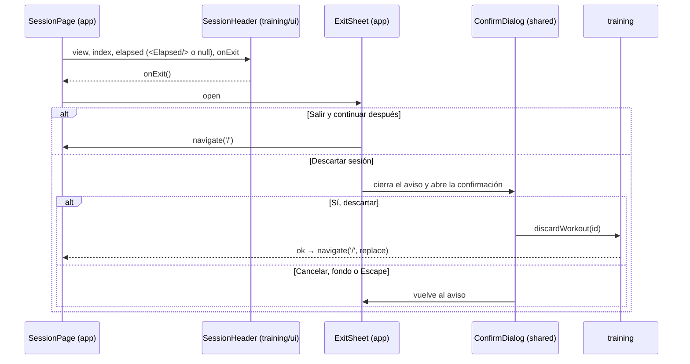

# Plan técnico: Rediseño de la sesión activa

**Spec:** `specs/004-rediseno-sesion/spec.md` · **Estado:** Aprobado (18-nov-2026)

## 1. Resumen de la solución

Sin tablas ni reglas nuevas: todo sale de `WorkoutView` y de `workoutProgress` (RN-TRN-21). `shared` gana un `Dialog` nativo genérico, sobre el que se reescribe `ConfirmDialog`. `training` cambia `SessionHeader` (una fila y menú flotante) y `SetTable` ("Seg", pistas y serie actual), y añade formatos de texto de la sesión. `app` reparte `SessionPage` en componentes de `app/pages/session/` (tarjeta, aviso de salida y pie) y mueve `Elapsed` para compartirlo con "Hoy".

## 2. Módulos afectados

| Módulo | Cambio | ¿Cambia el contrato? |
|---|---|---|
| `shared` | `Dialog` nuevo (`<dialog>` modal, abajo o arriba, cierre con fondo opcional); `ConfirmDialog` usa `Dialog` y gana `dismissOnBackdrop` | Sí: `modules/shared.md` §4 |
| `training` | `SessionHeader`: flecha, botón "Ejercicio N de M", hueco para el tiempo y menú flotante; `SetTable`/`SetRow`: "Seg", pistas, serie actual; `ui/format.ts` con `formatRange`, `formatTarget`, `formatSetCount` exportados | Sí: `modules/training.md` §4 (v1.18) |
| `app` | `SessionPage` como contenedor; `app/pages/session/`: `ExerciseCard`, `ExitSheet`, `SessionFooter`; `Elapsed` pasa a `app/pages/` y `formatElapsed` a `app/format-time.ts` | No (no es un módulo) |
| `plan` | Ninguno | No |

## 3. Cambios de contrato

Se escriben en `modules/*.md` y en `spec.md` al aprobar este plan, antes del código.

**`shared` (§4, `Dialog` y `ConfirmDialog`):**

```ts
function Dialog(props: {
  open: boolean;                      // controlado: true → showModal(), false → close()
  onClose: () => void;                // Escape (evento cancel) y, si dismissOnBackdrop, tocar el fondo
  placement: 'bottom' | 'top';        // hoja inferior con zona segura, o panel bajo el encabezado
  dismissOnBackdrop?: boolean;        // false por defecto
  labelledBy: string;                 // id del título visible
  describedBy?: string;
  initialFocus?: RefObject<HTMLElement | null>; // si falta, el primer control
  className?: string;
  children: ReactNode;
}): JSX.Element;

function ConfirmDialog(props: {
  // ...igual que antes
  dismissOnBackdrop?: boolean;        // false por defecto: "Hoy" no cambia
}): JSX.Element;
```

- `Dialog` tiene lo que hoy hace `ConfirmDialog`: `showModal()`, el foco inicial, Escape que llama a quien lo usa en vez de cerrar solo, y el foco devuelto al elemento que lo tenía al abrir (WebKit no siempre lo hace).
- Tocar el fondo: el `<dialog>` no tiene relleno y su contenido llena la caja, así que un clic cuyo `target` es el propio `<dialog>` cayó en `::backdrop`.
- `ConfirmDialog` no cambia ni de firma ni de comportamiento por defecto (foco en "Cancelar", abajo). Con `dismissOnBackdrop`, tocar el fondo llama a `onCancel`.
- El componente `Dialog` ya figuraba en la tabla de `shared/ui` sin firma; este plan se la da.

**`training` v1.18 (§4, API pública):**

```ts
function SessionHeader(props: {
  view: WorkoutView;
  index: number;                      // empieza en 1
  elapsed: ReactNode;                 // el tiempo lo pone app (usa Clock); null en una sesión de otro día
  onNavigate: (index: number) => void;
  onExit: () => void;                 // la flecha; el aviso de salida lo pone app
}): JSX.Element;

// ui/format.ts, reexportado por index.ts para que app no repita los textos de la sesión
export function formatRange(range: [number, number]): string;            // [6, 10] → "6-10"; [4, 4] → "4"
export function formatTarget(item: Pick<WorkoutItem, 'plannedSets' | 'repRange'>, metric: ExerciseFacts['metric']): string; // "2 × 6-10", "2 × 30-45 s"
export function formatSetCount(n: number): string;                       // "1 serie", "2 series"
```

- **`SessionHeader`:** una fila con la flecha ("Salir de la sesión", 44 × 44), el botón "Ejercicio N de M" (`aria-expanded`, `aria-haspopup="dialog"`, sin `aria-label`) y `elapsed`. El botón abre un `Dialog` con `placement="top"`, `dismissOnBackdrop`, título `h2` con `workout.name`, el resumen "N de M hechos · 1 en curso" y un botón por ítem con marca, nombre y subtítulo (spec §6.2). Elegir llama a `onNavigate` y cierra. Ya no tiene "Descartar sesión" ni `onDiscard`.
- **`SetTable`:** columna "Seg" en `metric: 'time'`; `placeholder` de reps (`formatRange(item.repRange)`) y de RIR (`formatRange(item.targetRir)`), sin pista en kg; la serie de menor `setNumber` sin hacer lleva `data-current` en su fila (como `data-state` en "Hoy": las pruebas no dependen de los nombres de clase). Firma igual.
- `SetRow` gana `hints: { reps: string; rir: string }` y `current: boolean`. Es interno (lo usa `SetTable`), aunque `index.ts` lo exporta.

**`spec.md` v0.8 (§7.2, fila "Sesión activa"):** "Encabezado con salida, 'Ejercicio N de M' (menú de ejercicios) y tiempo; aviso de salida (seguir, salir y continuar después, descartar); tarjeta del ejercicio compacta o completa (series, rango, RIR, consejo, alternativa); tabla de series (anterior, kg, reps, RIR, check); pie con 'Siguiente: …', 'Anterior' y 'Siguiente' (spec 004). Fase 3: 'Terminar y guardar'. Fase 4: sugerencia y temporizador."

## 4. Datos

Sin tablas, índices ni versión de Dexie nuevos (base v2). Sin cambios en la exportación. La elección compacta/completa vive en el estado de React (spec §6.4).

## 5. Flujo



## 6. Decisiones

### 6.1 Un `Dialog` en `shared`, con `ConfirmDialog` encima
Hay tres diálogos con el mismo ciclo (`showModal`, foco inicial, Escape, foco devuelto): la confirmación, el aviso de salida y el menú. Copiar ese ciclo tres veces es el error que WebKit ya castigó una vez (el foco devuelto). `Dialog` lo tiene una sola vez y `ConfirmDialog` pasa a ser una composición de él, con sus pruebas actuales como red. Alternativa descartada: que el aviso de salida sea un `ConfirmDialog` con más botones (otra firma para un caso que no confirma nada).

### 6.2 Tocar el fondo, opcional
El contrato actual dice que tocar fuera de `ConfirmDialog` no lo cierra, y "Hoy" lo usa así. La spec 004 pide que el fondo cierre el menú y el aviso, y que en la confirmación del descarte vuelva al aviso (AC-8, AC-13, AC-16). `dismissOnBackdrop` lo activa solo en la sesión; "Hoy" no cambia, porque ninguna spec lo pide (P-3).

### 6.3 El tiempo entra por props
`SessionHeader` vive en `training/ui` y no conoce `Clock` (lo cablea `app`, como las rutas). Recibe `elapsed: ReactNode`: la página le pasa `<Elapsed startedAt clock />` o `null`. `Elapsed` sigue siendo el único reloj de 1 s, y solo se vuelve a renderizar su texto (AC-36, spec 003 plan §6.5).

### 6.4 "Otro día" se decide al abrir
`SessionContent` calcula `useState(() => view.workout.date === clock.today())` una vez al montarse: el tiempo y el texto "y m:ss de entrenamiento" solo aparecen si es `true` (spec §8, decisión 9). Pasar de un ejercicio a otro no vuelve a montar `SessionContent`, así que la decisión no cambia hasta recargar.

### 6.5 La tarjeta recuerda la elección sin guardarla
`ExerciseScreen` se monta con `key={index}` (cada ejercicio empieza limpio: mensaje, diálogos, foco en el `h1`). El estado `expanded` sube a `SessionContent`, que no tiene `key`, y baja a `ExerciseCard` por props. Recargar lo devuelve a compacta (AC-22). Sin Zustand: un solo `useState` basta (ADR-0006 lo reserva para estado compartido entre pantallas).

### 6.6 Los textos de la sesión son de `training`
`app` no puede leer `plan/ui/format.ts` desde `training/ui` (architecture §5.2), y el menú de `SessionHeader` necesita "2 × 6-10". `training/ui/format.ts` tiene `formatRange`, `formatTarget` y `formatSetCount`, y `index.ts` los exporta para que la tarjeta y el pie de `app` usen los mismos. Repetir las cinco líneas de `formatSetsReps` de `plan` es más simple que una dependencia nueva (P-7). "RIR 3-4" se arma con `formatRange` (`plan` exporta `formatRir`, pero así la sesión no depende de `plan` en dos sitios).

### 6.7 Estructura de `app/pages`
- `SessionPage.tsx`: contenedor (consulta, redirección, `isToday`, `expanded`, `ExerciseScreen` con su `key`).
- `app/pages/session/ExerciseCard.tsx`: `h1`, línea compacta o chips, consejo y nota, "Cambiar a …" con su ayuda, mensaje de error y el botón "Ver detalles".
- `app/pages/session/ExitSheet.tsx`: el aviso de salida (un `Dialog` abajo) y la confirmación de descarte, con su secuencia (§6.8).
- `app/pages/session/SessionFooter.tsx`: la línea "Siguiente: …" o "Último ejercicio de hoy", y los enlaces.
- `app/pages/Elapsed.tsx` (se mueve desde `today/`) y `app/format-time.ts` con `formatElapsed` (se mueve desde `today/format.ts`). `ActiveSessionCard` cambia el import.
- `app/pages/session/format.ts`: "Llevas N de M ejercicios[ y m:ss de entrenamiento].", "Siguiente: <nombre> · <objetivo>".

### 6.8 Secuencia del aviso y la confirmación
`ExitSheet` tiene un estado `'closed' | 'exit' | 'confirm'`. "Descartar sesión" pasa de `exit` a `confirm`: el `Dialog` del aviso se cierra y se abre `ConfirmDialog` (dos `<dialog>` modales no pueden estar abiertos a la vez sin apilarse). "Cancelar", el fondo y Escape vuelven a `exit`. El foco: al abrir `exit` va a "Seguir entrenando"; al cerrar del todo vuelve a la flecha. Una prueba de componente comprueba el foco en cada paso, y el E2E en WebKit lo confirma (riesgo §8).

### 6.9 La serie actual se calcula en la tabla
Es la de menor `setNumber` sin hacer **del ejercicio que se ve** (spec AC-30), que no siempre es `progress.current`. `SetTable` ya tiene `sets`; el cálculo es una línea y no necesita el dominio. La señal es solo visual (spec §6.5).

### 6.10 Estilos
Sin tokens nuevos (ADR-0005): `--surface`, `--surface-2`, `--border`, `--accent`, `--warn`, `--text-muted`, `--backdrop`, `--radius-card`. El tiempo usa `font-variant-numeric: tabular-nums` para que la fila no salte cada segundo. El panel del menú, arriba con `max-height` y desplazamiento propio. Las opciones del aviso, ≥ 56 px.

### 6.11 Presupuesto del bundle
Bundle inicial actual: 161.91 kB de 200 kB. El cambio son componentes y textos, sin dependencias nuevas; se mide en la tarea de cierre del punto de control C.

**Medición (T12, 18-nov, con T1 a T11):** 163.58 kB de 200 kB gzip (`npm run build` y `npm run size`), +1.67 kB. AC-37 se cumple con 36 kB de margen.

## 7. Estrategia de pruebas

Sin dominio nuevo, así que no hay pruebas de dominio primero; las de componente se escriben antes que el componente cuando el comportamiento es nuevo (menú, aviso, tarjeta). Los nombres citan el AC.

| Criterio | Tipo de prueba | Archivo |
|---|---|---|
| `Dialog`: foco inicial y devuelto, Escape, fondo opcional | Componente | `shared/ui/__tests__/dialog.test.tsx` |
| `ConfirmDialog` sin cambios y con `dismissOnBackdrop` | Componente (las actuales siguen) | `shared/ui/__tests__/confirm-dialog.test.tsx` |
| `formatRange`, `formatTarget`, `formatSetCount` | Unitaria | `modules/training/__tests__/format.test.ts` |
| AC-1, AC-4 a AC-11 | Componente: fila, nombre accesible, menú, resumen, filas, `aria-current`, cerrar sin navegar | `modules/training/__tests__/session-header.test.tsx` |
| AC-26 a AC-30 | Componente: "Seg", pistas, serie actual | `modules/training/__tests__/set-table.test.tsx` |
| AC-2, AC-3 | Página con reloj fijo; `Elapsed` con temporizadores falsos (ya probado) | `app/__tests__/session-page.test.tsx`, `elapsed.test.tsx` |
| AC-12 a AC-18 | Página: aviso, secuencia con la confirmación, foco, navegación | `app/__tests__/session-exit.test.tsx` |
| AC-20 a AC-25 | Página: compacta/completa, se conserva entre ejercicios, tiempo, RIR 4 | `app/__tests__/session-page.test.tsx` |
| AC-31 a AC-34 | Página: línea del pie y enlaces | `session-page.test.tsx` |
| Textos de `app/pages/session/format.ts` | Unitaria | `app/__tests__/session-format.test.ts` |
| AC-14, AC-17, AC-19 | E2E: salir y continuar, descartar, campo sin confirmar | `tests/e2e/session.spec.ts` |
| AC-35 | E2E con axe: compacta, completa, menú, aviso y confirmación; 44 px; 320 px | `tests/e2e/a11y.spec.ts` |
| AC-36 | E2E: traza al marcar una serie (< 100 ms) | `tests/e2e/session.spec.ts` |
| AC-37 | `npm run size` tras `npm run build` | CI |
| AC-38 | E2E sin conexión | `tests/e2e/session.spec.ts` |

Las pruebas E2E y de página que usan "Ver ejercicios" o el descarte desde la lista pasan al menú y al aviso de salida. Tras cada prueba en verde se rompe el código a propósito, para ver que falla la prueba correcta (handoff, notas).

## 8. Riesgos

- **Dos `<dialog>` seguidos en WebKit:** cerrar uno y abrir otro en el mismo render puede dejar el foco en `body`. Se prueba en componente y en el E2E de WebKit; si falla, abrir el segundo en el efecto siguiente al cierre del primero.
- **Clic en el fondo en iOS:** el toque en `::backdrop` llega como clic sobre el `<dialog>` solo si su contenido llena la caja. Se verifica en el iPhone (tarea de cierre).
- **Panel del menú con muchos ejercicios a 320 px:** `max-height` y desplazamiento propio; el E2E lo prueba con la plantilla más larga del seed.
- **`aria-haspopup="dialog"` en VoiceOver:** se anuncia distinto entre versiones; el nombre accesible sigue siendo el texto visible (WCAG 2.5.3), que es lo que exige AC-35.
- **Foco al navegar desde el menú:** el menú se desmonta con su `ExerciseScreen`; el foco debe acabar en el `h1` nuevo, no en el botón viejo. Prueba de página con `waitFor` (handoff, notas).

## 9. Checklist de la constitución

- [x] **P-1:** no se sugiere ningún ejercicio; "Cambiar a …" sigue con las alternativas del seed validado.
- [x] **P-2:** sin cambios de esquema; salir no toca datos; descartar pide confirmación y no borra nada (RN-TRN-15).
- [x] **P-3:** los cambios de contrato de §3 se escriben antes del código; sin `[POR DEFINIR]`. "Hoy" no cambia (§6.2).
- [x] **P-4:** `training/ui` no conoce rutas ni `Clock` (§6.3); no importa `plan` (§6.6); `app` combina.
- [x] **P-5:** sin dominio nuevo; RN-TRN-21 ya probado.
- [x] **P-6:** reloj aislado (§6.3), ≥ 44 px, axe y 320 px (AC-35), < 100 ms (AC-36), bundle (AC-37).
- [x] **P-7:** un solo `Dialog` para tres usos; sin Zustand; sin opciones que nadie use.
- [x] **P-8:** sin entradas externas nuevas; textos en español.
