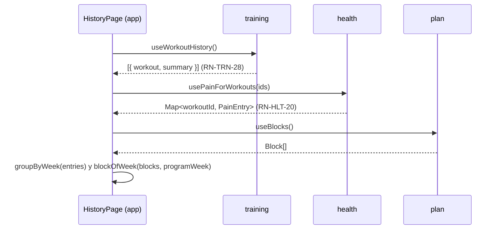

# Plan técnico: Historial de sesiones

**Spec:** `specs/006-historial/spec.md` · **Estado:** Aprobado (19-nov-2026)

## 1. Resumen de la solución

Cada módulo añade una pieza pequeña, con pruebas primero:
- **`training`:** la lista con resumen en una consulta (RN-TRN-28) y el detalle como función pura (RN-TRN-29);
- **`health`:** el dolor de varias sesiones (RN-HLT-20) y las etiquetas de las señales;
- **`plan`:** el bloque de una semana del programa (RN-PLN-28).

`app` arma la lista (`/historial`), el detalle (`/historial/:workoutId`), la pestaña nueva y los enlaces de "Hoy".

No hay tablas, índices ni migración nuevos. La base sigue en la v3.

## 2. Módulos afectados

| Módulo | Cambio | ¿Cambia el contrato? |
|---|---|---|
| `training` | `listWorkoutHistory` y `useWorkoutHistory`; `findCompletedStates` en el repositorio (Dexie y memoria); `historyDetail` en `domain/history.ts`; `formatDoneSet` | Sí: `modules/training.md` v1.25 |
| `health` | `getPainForWorkouts` y `usePainForWorkouts`; `findByWorkoutIds` en el repositorio; `formatRedFlags` con las etiquetas que hoy viven en `RedFlagsChecklist` | Sí: `modules/health.md` v1.10 |
| `plan` | `getBlocks` y `useBlocks`; `blockOfWeek` pura en el dominio | Sí: `modules/plan.md` v1.18 |
| `app` | Rutas, `TabBar`, `app/pages/history/`, `formatWeekRange`, `formatBackChip` movido a `app/format-pain.ts`, `DayCard`, `OtherDays` y `TodayPage` | No (no es un módulo) |
| `progression`, `data`, `shared` | Ninguno | No |

## 3. Cambios de contrato

Se escriben en los contratos en el mismo PR que este plan, antes del código.

**`training` v1.25**
```ts
interface HistoryEntry { workout: Workout; summary: WorkoutSummary }        // RN-TRN-28
interface TrainingApi {
  // …
  listWorkoutHistory(): Promise<HistoryEntry[]>;   // todos los completed, en el orden de RN-TRN-26
}
export function useWorkoutHistory(training: TrainingApi): HistoryEntry[] | undefined;  // [] sin sesiones

interface HistoryItem { exerciseId: ID; replaces: ID | null; sets: SetLog[] }   // RN-TRN-29
export function historyDetail(view: Pick<WorkoutView, 'workout' | 'sets'>): HistoryItem[] | null;
export function formatDoneSet(set: SetLog, metric: Exercise['metric']): string; // "100 × 10 · RIR 2"
```
- `listWorkoutHistory` no recibe rango (decisión 6.1). `listWorkouts(range)` sigue igual para "Hoy".
- `replaces` es `options[0]` si el elegido es otro; si no, `null`.
- `formatDoneSet` usa el valor de `formatPrevious` ("100 × 10", "Asist. 20 × 8", "12", "40 s") y añade " · RIR r". El número de la serie y "Extra" los pone `app`, que maqueta la línea.

**`health` v1.10**
```ts
export function formatRedFlags(flags: RedFlag[]): string;  // etiquetas del Cierre, en el orden de RED_FLAGS, con ", "
```
`getPainForWorkouts` y `usePainForWorkouts` ya están en v1.9 (RN-HLT-20). Las etiquetas pasan de `RedFlagsChecklist.tsx` a `ui/labels.ts`, y el componente las importa de allí. Así el Cierre y el historial usan el mismo texto.

**`plan` v1.18**
```ts
interface PlanApi {
  // …
  getBlocks(): Promise<Block[]>;                   // por startWeek; sin programa lanza (RN-PLN-22)
}
export function useBlocks(plan: PlanApi): Block[] | undefined;
export function blockOfWeek(blocks: Block[], week: number): Block | null;   // RN-PLN-28, pura
```

## 4. Datos

- Sin tablas ni índices nuevos; la base sigue en la v3 (spec AC-39). Sin cambio en el formato de exportación.
- **`findCompletedStates`** (training): en una transacción `r` sobre `workouts` y `sets`:
  - `workouts.where('status').equals('completed')`, con el índice `status`, que existe desde la v2;
  - después, `sets.where('workoutId').anyOf(ids)`, agrupadas por workout.

  Son dos lecturas para toda la lista, sin importar cuántas sesiones haya (RN-TRN-28).
- **`findByWorkoutIds`** (health): `painEntries.where('workoutId').anyOf(ids)`, con el índice único `&workoutId`.
- **`getBlocks`** (plan): lee el snapshot que ya carga `loadSnapshot` y devuelve sus bloques ordenados por `startWeek`.

## 5. Flujo

Solo lectura. `app` combina tres módulos sin que se conozcan entre sí:



El detalle sigue el mismo patrón:
- `useWorkoutView(id)` (ya existe);
- `historyDetail(view)`;
- `usePainForWorkouts([id])`;
- `useBlocks` no se usa: el detalle muestra "Semana N" sin el bloque (spec §6.2).

## 6. Decisiones

### 6.1 La lista lee todo, sin rango
La spec pide todas las sesiones. Un rango ficticio enorme en `listWorkouts` ocultaría la intención. `listWorkoutHistory()` no recibe parámetros y usa el índice `status`. El orden es el de RN-TRN-26, por `date` y luego `startedAt` con `compareInstants`, y lo hace el servicio, como en `listWorkouts`. El resumen se calcula con `workoutSummary(state, state.workout.startedAt)`. Un `completed` siempre tiene `finishedAt`, así que `now` no cuenta; un dato roto sin él da 0 min, y la consulta no depende del reloj (RN-TRN-28, contrato v1.27).

### 6.2 El detalle es puro y reutiliza `useWorkoutView`
`useWorkoutView` ya trae el workout, las series y los ejercicios (con nombres). `historyDetail` solo filtra y ordena, sin consultas nuevas.

Devuelve `null` si el workout no está `completed`. La página muestra "Esta sesión no está en el historial." si la vista es `null` o `historyDetail` devuelve `null` (AC-30).

Va en `domain/history.ts`, junto a la lógica de `getExerciseHistory`, porque las dos aplican RN-TRN-08.

### 6.3 El bloque se resuelve con `getBlocks` + `blockOfWeek`
Una lectura para toda la lista, y la regla pura en el dominio, probada primero.

Se descartó `getBlockForWeek(week)`: haría una llamada por grupo y escondería la regla en el servicio.

El programa no cambia en v1, pero `useBlocks` usa `useLiveQuery` como los otros hooks de `plan` (RN-PLN-26), para no hacer una excepción.

### 6.4 `formatRedFlags` en `health`
Las etiquetas son de `health` (spec 005). Copiarlas en `app` permitiría que el Cierre y el historial dijeran cosas distintas.

### 6.5 Páginas sin carga diferida
Las dos páginas entran en el bundle inicial, como las demás. `React.lazy` complicaría el modo sin conexión (el *chunk* debe estar en el precache) para ahorrar unos pocos kB (P-7). Se mide en la tarea de cierre (§6.11).

### 6.6 Rutas y pestaña
- `router.tsx`: `historial` y `historial/:workoutId`, dentro del layout con `TabBar`, como `progreso`.
- `TabBar`: `NavLink to="/historial"` entre "Hoy" y "Progreso", con un icono SVG de lista (`aria-hidden`). `NavLink` marca la pestaña también en `/historial/:id`, porque no lleva `end` (AC-3).
- "Hoy" usa un `Link` con `aria-current` calculado (handoff), así que no se marca en el historial.

### 6.7 Lista (`app/pages/history/HistoryPage.tsx`)
**Espera a las tres consultas.** No muestra el estado vacío mientras alguna está en `undefined` (spec §6.4).

**Agrupa** con `groupByWeek(entries)` (`history/group.ts`, pura):
- Clave: `startOfIsoWeek(workout.date)`. Los grupos salen en el orden de las entradas, que ya vienen de la más reciente a la más antigua.
- Cada grupo lleva `{ weekStart, programWeek, entries }`.
- `programWeek` es el de la entrada más reciente del grupo (spec §7).

**Encabezado de cada grupo:**
- con `programWeek`, `h2` "Semana N" y debajo `blockOfWeek(blocks, N)?.name` · `formatWeekRange(weekStart)`;
- sin `programWeek`, "Fuera del programa" y solo el rango.

**`HistoryRow`:** un `Link` de ≥ 44 px con `state: { from: '/historial' }`.
- **Primera línea:** `formatShortDay(date)` · nombre.
  - Si `plannedFor ≠ date`, el nombre va como `${name} del ${formatWeekday(plannedFor)}`.
- **Segunda línea:** `formatHistorySummary(summary)`, que da "52 min · 10 series · 7 ejercicios".
  - Reutiliza `minutesFigure`, `setsFigure` e `itemsFigure` del Cierre.
  - Esas figuras pasan de `close/format.ts` a `app/format-summary.ts`, porque ahora las usan dos páginas.
- **Chips:**
  - "Espalda N/10" con `formatBackChip`, ámbar desde 4;
  - "Señal de alarma" si `redFlags.length > 0`.
- El chevron es `aria-hidden`. El nombre accesible es el texto visible (WCAG 2.5.3, handoff).

### 6.8 Detalle (`app/pages/history/HistoryDetailPage.tsx`)
**Encabezado:**
- `BackLink` (flecha, `aria-label="Volver"`, 44 px) al `state.from` validado: solo `'/'` o `'/historial'`, como `ClosePage` (plan 005 §6.6); sin él, `/historial`.
- `h1` con el nombre.
- La línea `formatLongDateTitle(date)` · "Semana N", más "sesión del <día>" si `plannedFor ≠ date`.

**Resumen:** `CloseSummary` se generaliza a `SummaryFigures` en `app/pages/` con `showTime` siempre `true`. El Cierre lo sigue usando igual.

**Dolor lumbar:**
- "N/10" con la clase ámbar desde 4.
- "Señales de alarma: " + `formatRedFlags`.
- Sin entrada: "Sin registro" (AC-32).

**Ejercicios:** por cada `HistoryItem`:
- `h3` con `exercises[exerciseId].name`, o "Ejercicio desconocido" (spec §7);
- "En lugar de <nombre de `replaces`>" si lo hay;
- una `<ol>` con `${setNumber} · ${formatDoneSet(set, metric)}`, más " · Extra" si `isExtra`;
- sin series: `h3` en `--text-muted` y "Sin series".

**Notas:** el texto con `white-space: pre-line`, solo si existe.

### 6.9 "Hoy"
**`DayCard`:** el `DoneDay` añade `workoutId`, y la tarjeta hecha añade el `Link` "Ver detalle" (≥ 44 px, secundario) a `/historial/${workoutId}` con `state: { from: '/' }`.

**`OtherDays`:**
- `days` pasa de `done: boolean` a `doneId: ID | null`.
- Una fila hecha es un `Link` gris al detalle, con el mismo `state`, y su nombre incluye "hecha".
- `TodayPage` toma el id con `completed.find((w) => w.plannedFor === dayDate)`. `completed` viene de la más reciente a la más antigua, así que con dos sesiones del mismo día gana la más reciente (spec AC-35), la misma que muestra la tarjeta.

### 6.10 Textos y formatos
- **`app/pages/history/texts.ts`:**
  - "Historial";
  - el vacío de AC-4;
  - "Esta sesión no está en el historial.";
  - "Ver el historial";
  - "Fuera del programa";
  - "Sin series", "Sin registro", "Extra";
  - "En lugar de …", "Señales de alarma: …", "Señal de alarma";
  - "Ver detalle", "Volver".
- **`formatWeekRange(weekStart)`** en `app/format-date.ts`: "16-22 nov"; si cruza de mes, "30 nov-6 dic"; si cruza de año, "28 dic-3 ene". Quita el punto del mes corto, como `formatShortDateTitle`.
- **`formatBackChip`** pasa de `today/format.ts` a `app/format-pain.ts`.

### 6.11 Presupuesto del bundle
Bundle inicial actual: 169.00 kB de 200 kB. Entran dos páginas, tres hooks y unos formatos, sin dependencias nuevas: se estiman 3 a 5 kB. Se mide en la tarea de cierre (`npm run build` y `npm run size`).

## 7. Estrategia de pruebas

Las reglas nuevas van **prueba primero**: commit en rojo local, que se sube con la tarea que lo pone en verde. Los nombres citan la regla o el AC.

| Criterio | Tipo de prueba | Archivo |
|---|---|---|
| RN-PLN-28 (`blockOfWeek`: dentro, en los bordes, fuera, semana 0 y más allá de la última) | Dominio, primero | `modules/plan/__tests__/schedule.test.ts` |
| `getBlocks` (orden, sin programa lanza RN-PLN-22), `useBlocks` | Servicio y hook | `modules/plan/__tests__/plan-service.test.ts`, `hooks.test.tsx` |
| RN-TRN-29 (`historyDetail`) | Dominio, primero | `modules/training/__tests__/history.test.ts` |
| RN-TRN-28 (`listWorkoutHistory`: solo `completed`, orden, resumen, series de cada uno) | Servicio con memoria y repositorio Dexie, primero | `training-service.test.ts`, `dexie-repository.test.ts` |
| `useWorkoutHistory` (`undefined`, `[]`, se actualiza al cerrar) | Hook | `modules/training/__tests__/hooks.test.tsx` |
| `formatDoneSet` (peso, asistencia, reps, tiempo) | Unitaria | `modules/training/__tests__/format.test.ts` |
| RN-HLT-20 (`getPainForWorkouts`: ids sin entrada, repetidos, lista vacía sin leer, fallo de la base) | Servicio sobre Dexie, primero | `modules/health/__tests__/health-service.test.ts` |
| `usePainForWorkouts` (clave por ids, se actualiza con `painEntries`) | Hook | `modules/health/__tests__/hooks.test.tsx` |
| `formatRedFlags`; `RedFlagsChecklist` sigue con los mismos textos | Unitaria y componente | `modules/health/__tests__/pain-ui.test.tsx` |
| `groupByWeek`, `formatWeekRange`, `formatHistorySummary` | Unitaria | `app/__tests__/history-format.test.ts` |
| AC-1 a AC-3 | Página (rutas y barra) | `app/__tests__/router.test.tsx` |
| AC-4 a AC-13 | Página | `app/__tests__/history-page.test.tsx` |
| AC-14 a AC-32 | Página | `app/__tests__/history-detail.test.tsx` |
| AC-33 a AC-35 | Página | `app/__tests__/today-done.test.tsx` |
| Recorrido: cerrar una sesión, verla en "Historial" y abrir su detalle desde la lista y desde "Hoy"; sin conexión (AC-37) | E2E | `tests/e2e/history.spec.ts` |
| AC-36 | E2E con axe, 44 px y 320 px | `tests/e2e/a11y.spec.ts` |
| AC-38 | `npm run size` tras `npm run build` | CI |

**Más detalle:**
- **Dominio (RN-TRN-29):**
  - Un ítem con alternativa elegida y una serie hecha del principal (de antes de cambiar) no muestra esa serie.
  - Una serie extra hecha sale con su `setNumber`.
  - Un workout `in_progress` da `null`.
- **Repositorio (RN-TRN-28):** dos workouts con series cada uno: cada resumen cuenta solo las suyas. Debe morir un mutante que no filtra por `workoutId` o que olvida `completed`.
- **Página de la lista:** datos de la spec §4, escritos con la API (`startWorkout`, `logSet`, `toggleSetDone`, `finishWorkout`). AC-11 escribe directo en la base (`lastTestDatabase()`, handoff).
- **Estabilidad:** `--grep "spec 006" --repeat-each=5` en Chromium y WebKit.

Tras cada prueba en verde se rompe el código a propósito, para ver que falla la prueba correcta.

## 8. Riesgos

- **`date` frente a `plannedFor`:** el grupo y la fecha van por `date`; "del viernes" y los enlaces de "Hoy", por `plannedFor`. Lo cubren AC-8, AC-15 y AC-34 con M18.
- **Mover piezas compartidas** (`formatBackChip`, las figuras del Cierre, `CloseSummary`, las etiquetas de las señales) puede romper el Cierre y "Hoy". Sus pruebas actuales deben pasar sin cambios, salvo las rutas de importación.
- **`OtherDays` de texto a enlace:** cambia AC-32 de la spec 005 ("no pulsable"). Se actualizan sus pruebas y E2E y se cita la spec 006 AC-34, como se hizo en la 005b.
- **Rendimiento con muchas sesiones:** dos lecturas por índice. Si en la verificación la lista tarda más de 100 ms con 200 sesiones de prueba, se propone una carga por partes en otra spec (spec §7).
- **Tres hooks en la lista:** si uno queda en `undefined` por una clave mal formada, la página se queda cargando. La clave de `usePainForWorkouts` son los ids unidos; la prueba del hook cubre el cambio de lista.

## 9. Checklist de la constitución

- [x] **P-1:** el historial no sugiere nada; los consejos de salud no salen en él.
- [x] **P-2:** solo lectura; sin cambio de esquema ni migración.
- [x] **P-3:** contratos `training` v1.25, `health` v1.10 y `plan` v1.18 en el mismo PR que este plan, antes del código; sin `[POR DEFINIR]`.
- [x] **P-4:** `app` compone tres módulos por sus `index.ts`; cada módulo lee sus tablas; ningún import nuevo entre módulos.
- [x] **P-5:** RN-HLT-20, RN-TRN-28, RN-TRN-29 y RN-PLN-28 con pruebas primero; `historyDetail` y `blockOfWeek` puros.
- [x] **P-6:** filas, "Volver" y "Ver detalle" ≥ 44 px; axe y 320 px; bundle medido.
- [x] **P-7:** sin rango ficticio, sin carga diferida, sin paginación; las piezas compartidas se mueven en vez de copiarse.
- [x] **P-8:** sin entradas externas nuevas; textos en español.
