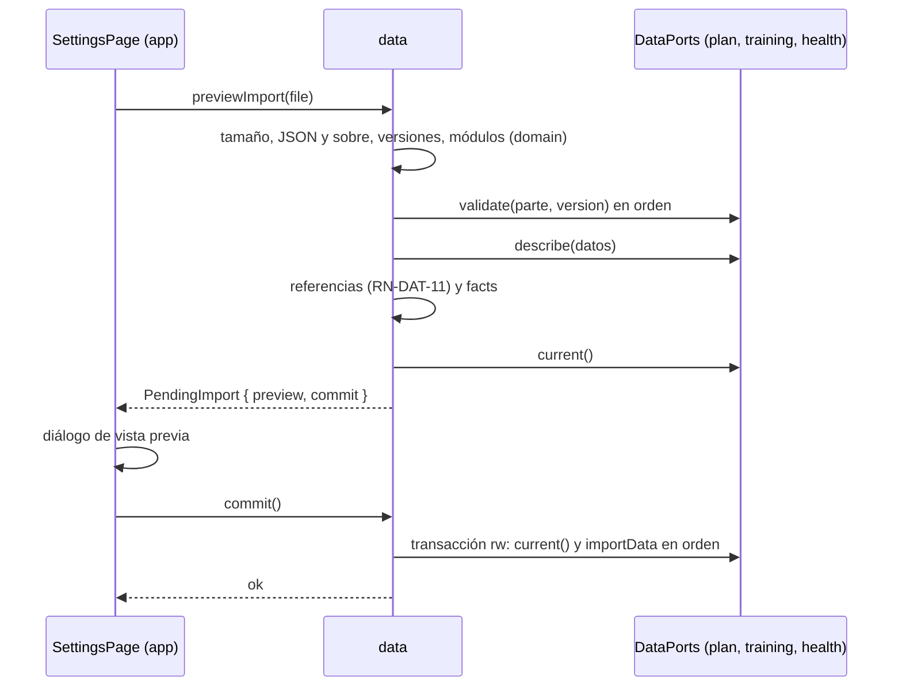

# Plan técnico: Respaldo (exportar e importar JSON)

**Spec:** `specs/007-respaldo/spec.md` · **Estado:** Aprobado (19-nov-2026)

## 1. Resumen de la solución

`data` deja de ser un esqueleto: exporta e importa todo a través de los `DataPort` que `compose` registra, sin conocer los módulos.

- **`shared/kernel`:** `DataPort` gana `describe(data)` (cifras para la vista previa y referencias entre módulos) y `current()` (estado local), y pierde `wipe` hasta RF-43. Esquemas primitivos de Zod compartidos (`ID`, `LocalDate`, `Instant`).
- **`plan`, `training`, `health`:** cada uno implementa su `dataPort`: esquema Zod, reglas propias, `describe`, `current` y reemplazo de sus tablas.
- **`data`:** dominio puro (sobre, versiones, referencias, vista previa) y servicio (`exportAll`, `previewImport` → `PendingImport` con `commit()`), con la transacción única sobre las tablas de todos los puertos.
- **`app`:** pestaña "Ajustes", `/ajustes` con la sección "Respaldo" y el aviso, entrega del archivo (compartir o descargar), diálogo de vista previa y textos de error.

Sin tablas, índices ni migración: la base sigue en la v3 (AC-43).

## 2. Módulos afectados

| Módulo | Cambio | ¿Cambia el contrato? |
|---|---|---|
| `shared` | `DataPort` con `describe` y `current`, sin `wipe`; tipos `ImportFacts`, `LocalFacts`, `DataDescription`; `kernel/schemas.ts` con `idSchema`, `localDateSchema` e `instantSchema` (`zod/mini`) | Sí: `modules/shared.md` §2 |
| `data` | `createData({ db, clock })`, `registerDataPort`, `exportAll`, `previewImport`, `PendingImport`; `domain/` puro (sobre, versiones, referencias, vista previa) | Sí: `modules/data.md` v1.2 |
| `plan` | `dataPort` (`infrastructure/data-port.ts`, `backup-schema.ts`), `id` del seed pasa a `kernel/schemas.ts` | Sí: `modules/plan.md` v1.21 (RN-PLN-29) |
| `training` | `dataPort`, reglas del respaldo en `domain/backup.ts`, esquema en `infrastructure/backup-schema.ts` | Sí: `modules/training.md` v1.30 (RN-TRN-30) |
| `health` | `dataPort`, reglas en `domain/backup.ts` (pruebas primero, P-5), esquema en `infrastructure/backup-schema.ts` | Sí: `modules/health.md` v1.13 (RN-HLT-21) |
| `app` | `compose` registra los puertos; `TabBar` con 4 pestañas; ruta `ajustes`; `app/pages/settings/`; `deliverFile`; textos de `data/*` en `errors/messages.ts`; formatos de fecha nuevos | No (no es un módulo) |
| `progression` | Ninguno | No |

## 3. Cambios de contrato

Se escriben en los contratos en el mismo PR que este plan, antes del código.

**`shared` §2 (`kernel/data-port.ts`)**
```ts
export interface ImportFacts {            // cifras que aporta cada puerto; data las junta (RN-DAT-13)
  completedWorkouts?: number;
  doneSets?: number;                      // series hechas de las sesiones completed
  painEntries?: number;
  dateRange?: { from: LocalDate; to: LocalDate } | null;
  hasActiveWorkout?: boolean;
  programStartDate?: LocalDate;
}
export interface LocalFacts { completedWorkouts?: number; hasActiveWorkout?: boolean }
export interface DataDescription {
  facts: ImportFacts;
  provides: Record<string, readonly ID[]>;   // 'exercise', 'workout'
  requires: Record<string, readonly ID[]>;
}
export interface DataPort<T = unknown> {
  name: string;
  version: number;
  order: number;
  tables: string[];
  exportData(): Promise<T>;                                   // filas tal como están guardadas
  validate(raw: unknown, fromVersion: number): Result<T>;     // migra, esquema Zod y reglas propias
  describe(data: T): DataDescription;                         // pura
  current(): Promise<LocalFacts>;                             // solo lecturas Dexie: corre dentro de la transacción
  importData(data: T): Promise<void>;                         // vacía sus tablas y escribe; dentro de la transacción
  csv?(): Promise<{ filename: string; content: string }>;
}
```
`kernel/schemas.ts` (`zod/mini`, `jitless`): `idSchema` (UUIDv7 en minúsculas, hoy en `seed-schema.ts`), `localDateSchema` (`AAAA-MM-DD` y fecha real), `instantSchema` (ISO 8601 con offset). Las tres salen con su tipo *branded*.

**`data` v1.2**
```ts
export function createData(deps: { db: Dexie; clock: Clock }): DataApi;
export type DataErrorCode =
  | 'data/file-too-large' | 'data/not-gym-app-file' | 'data/unsupported-version'
  | 'data/invalid-module-data' | 'data/workout-in-progress';
interface InvalidModuleDataDetails {
  module: string | null;                  // null: el sobre (módulos que faltan o sobran)
  cause: string;                          // código del puerto ('plan/high-risk-exercise'…) o 'data/missing-reference'
  details?: unknown;                      // los details del puerto, o { kind, id } de la referencia rota
}
interface DataApi {
  registerDataPort<T>(port: DataPort<T>): void;   // lanza con un name u order repetido (§6.4)
  exportAll(): Promise<{ filename: string; blob: Blob }>;
  previewImport(file: Blob): Promise<Result<PendingImport, DataError>>;
}
interface PendingImport {
  preview: ImportPreview;                 // RN-DAT-13, como en v1.1
  commit(): Promise<Result<void, DataError>>;   // RN-DAT-03, 04, 05, 10; una sola vez
}
```
- `onImported` y `TransactionRunner` salen: no hay nada que reconstruir hasta la fase 4 y la transacción se abre con `db`.
- §4 cambia `programs: []` por `program: {}` (decisión 1).

**`plan` v1.21 · RN-PLN-29 (respaldo del plan)**
- Formato: `{ exercises, program, blocks, templates }`, el del seed con `startDate` dentro de `program`.
- `validate`: `planBackupSchema` (el del seed + `startDate`) y después `validateSeed` sobre lo mismo sin `startDate` (RN-PLN-07 primero, RN-PLN-15, 19). Un fallo de esquema es `plan/invalid-seed` con sus `issues`; uno de reglas, su código (`plan/high-risk-exercise`…).
- `describe`: `provides.exercise` = IDs del catálogo; `facts.programStartDate`.
- `current`: `{}`.
- `exportData` lee las 4 tablas en una transacción `r` (más de un programa lanza, RN-PLN-25); `importData` vacía las 4 y escribe con `bulkAdd`.
- `name: 'plan'`, `version: 1`, `order: 10`.

**`training` v1.30 · RN-TRN-30 (respaldo de training)**
- Formato: `{ workouts, sets }`, todas las filas en cualquier estado.
- `validate`: esquema estricto de `Workout`, `WorkoutItem` y `SetLog` (opcionales `finishedAt`, `notes`, `note`, `completedAt` con `exactOptional`); después reglas puras (`checkTrainingBackup`): IDs únicos en cada tabla; cada serie con un `workoutId` del archivo; como mucho un `in_progress` (RN-TRN-01). Código `training/invalid-backup` con `details: { rule, … }` (`rule: 'schema'` con `issues` para el esquema). No comprueba RN-TRN-06 ni 27 (RN-DAT-12).
- `describe`: `provides.workout`; `requires.exercise` = `exerciseId` y `options` de cada ítem y `exerciseId` de cada serie; `facts`: `completedWorkouts`, `doneSets` (hechas de los `completed`), `dateRange` (`date` mínima y máxima de los `completed`, `null` sin ninguno; `LocalDate` sí se compara como texto), `hasActiveWorkout`.
- `current`: `completedWorkouts` (índice `status`) y `hasActiveWorkout`.
- `name: 'training'`, `version: 1`, `order: 20`.

**`health` v1.13 · RN-HLT-21 (respaldo de health)**
- Formato: `{ painEntries }`.
- `validate`: esquema estricto de `PainEntry` (nivel entero 0-10, banderas de `RED_FLAGS` sin repetir); reglas puras (`checkHealthBackup`): IDs únicos y una entrada por `workoutId` (RN-HLT-09). Código `health/invalid-backup`.
- `describe`: `requires.workout` = `workoutId` de cada entrada; `facts.painEntries`.
- `current`: `{}`.
- `name: 'health'`, `version: 1`, `order: 30`.

## 4. Datos

- Sin tablas ni índices nuevos; la base sigue en la v3. El formato de exportación nace en la versión 1 (`schemaVersion: 1` y `version: 1` por módulo).
- **Exportar:** una transacción `r` sobre las tablas de todos los puertos, `Promise.all(ports.map((p) => p.exportData()))`, para que el archivo sea una foto consistente.
- **Importar:** una transacción `rw` sobre las mismas tablas. Dentro: `current()` de cada puerto (RN-DAT-05 otra vez) y, si no hay sesión en curso, `importData` en orden de `order`. Dentro solo se esperan promesas de Dexie (handoff: zona de Dexie). Si algo lanza, Dexie aborta y nada cambia (RN-DAT-03).
- **Ida y vuelta:** las filas viajan tal cual. Una clave con `undefined` en Dexie desaparece en JSON; los esquemas usan `exactOptional` y las pruebas comparan base contra base con `toStrictEqual` sobre los objetos leídos, para que un `undefined` explícito se note.

## 5. Flujo



## 6. Decisiones

### 6.1 Formato del plan como el seed (decisión 1, aprobada)
Reutiliza `planSeedSchema` y `validateSeed`: el plan del archivo pasa exactamente las mismas reglas que el seed, también P-1. `planBackupSchema` se construye con las mismas piezas y cambia solo `program`.

### 6.2 Referencias por `describe` (decisión 2, aprobada)
`data/domain/references.ts`: `missingReference(descriptions)` recorre los puertos en orden y devuelve el primer `{ module, kind, id }` cuyo `requires` no esté en la unión de los `provides`, o `null`. Ningún módulo conoce a otro ni cambia `config/module-graph.json`. Un `kind` que nadie ofrece cuenta como roto: obliga a registrar los puertos completos.

### 6.3 Vista previa con `facts` (decisión 3, aprobada)
`data/domain/preview.ts`: `buildPreview(envelope, descriptions, local)` junta los `facts` (cada campo lo aporta un solo puerto) y rellena lo que falta: 0, `null` o `false`. `programStartDate` es obligatorio: sin él, el archivo no tiene plan y ya habría fallado antes; si faltara, es un bug y lanza.

### 6.4 `DataPort` en el kernel (decisión 4, aprobada)
Se añaden `describe` y `current`; `wipe` sale hasta RF-43. `registerDataPort` rechaza (lanza) un nombre repetido o un `order` repetido: es un error de composición, no del usuario.

### 6.5 `PendingImport` con `commit()` (decisión 5, aprobada)
Los datos validados viven en el cierre de `commit`, que no se puede llamar con datos inventados. Una segunda llamada lanza. `createData({ db, clock })`.

### 6.6 Esquemas en `zod/mini` sin carga diferida (decisión 6, aprobada)
Mismo estilo que el seed (`strictObject`, `exactOptional`, `jitless`). Los primitivos (`idSchema`, `localDateSchema`, `instantSchema`) pasan a `shared/kernel/schemas.ts` para no repetirlos en tres módulos; `zod/mini` ya está en el bundle por el seed. Si `npm run size` pasa de 190 kB, `SettingsPage` entra con `React.lazy` (otro PR).

### 6.7 Entrega del archivo (decisión 7, aprobada)
`app/pages/settings/deliver.ts`, `deliverFile(file, env)` con `navigator` y `document` inyectables:
1. Si `navigator.canShare?.({ files: [file] })`, `await navigator.share({ files: [file], title: file.name })`. `AbortError` → fin, sin mensaje (AC-6). Otro error → paso 2.
2. `URL.createObjectURL(file)`, un `<a download={file.name}>` temporal añadido al documento, `click()`, quitarlo, y `revokeObjectURL` en un `setTimeout(…, 60_000)` (spec §8, decisión 15: con 0 Safari puede cortar la descarga).

Sin `canShare` (aunque exista `share`) se descarga. Devuelve `'shared'`, `'cancelled'` o `'downloaded'`.

`exportAll` devuelve `{ filename, blob }`; `app` crea el `File` con `type: 'application/json'`.

### 6.8 Página y textos (decisión 8, aprobada)
- `router.tsx`: `ajustes` dentro del layout con `TabBar`.
- `TabBar`: `NavLink to="/ajustes"` después de "Progreso", icono de engranaje `aria-hidden`. Las pestañas ya son `flex: 1`; a 320 px quedan 80 px cada una.
- `app/pages/settings/`:
  - `SettingsPage.tsx`: `h1`, `BackupSection` y la sección "Aviso".
  - `BackupSection.tsx`: botones, `<input type="file" hidden>` con su `ref`, estado `idle | checking | pending | restoring` y la zona de mensajes (`role="status"` para "Respaldo restaurado.", `role="alert"` para errores; un mensaje a la vez).
  - `ImportDialog.tsx`: `Dialog` de `shared` (`data-placement="bottom"`, `dismissOnBackdrop`), las líneas de la vista previa y los botones; foco inicial en "Cancelar".
  - `texts.ts` y `format.ts` (`formatPreviewCounts`, con singulares).
- `app/errors/messages.ts`: `DataErrorCode → texto`, cubierto por `tsc` como los demás; `describeImportError(error)` devuelve el texto de P-1 si `details.cause === 'plan/high-risk-exercise'`.
- `app/format-date.ts`: `formatInstantLong` ("19 de noviembre de 2026, 22:30", hora local), `formatDateRangeLong` ("Del 16 al 18 de noviembre de 2026"; "Del 30 de noviembre al 6 de diciembre de 2026"; "Del 28 de diciembre de 2026 al 3 de enero de 2027") y `formatWeekdayDateLong` ("lunes 16 de noviembre de 2026"). Detalle aprobado antes de T14 en la spec §8, decisión 14: hora armada a mano en 24 h sin cero inicial, rango de un día ("El 16 de noviembre de 2026"), singulares y el aviso de reemplazo (`formatReplaceWarning`, en `settings/format.ts` junto a `formatPreviewCounts`).
- Mientras dura `restoring`, "Reemplazar mis datos" dice "Restaurando…" y el diálogo no se cierra con Escape ni con el fondo.

### 6.9 Orden de la revisión (`previewImport`)
Cada paso devuelve el primer error (RN-DAT-02):
1. `file.size > 10 * 1024 * 1024` → `data/file-too-large`, sin leer.
2. `await file.text()`, `JSON.parse` y el sobre (`envelopeSchema`: `app: 'gym-app'`, `schemaVersion` entero ≥ 1, `exportedAt` `Instant`, `modules` con `{ version: entero ≥ 1, data }` por clave; estricto) → `data/not-gym-app-file`.
3. `schemaVersion > 1` o la versión de algún módulo registrado mayor que la de su puerto → `data/unsupported-version`.
4. Las claves de `modules` distintas de los puertos registrados → `data/invalid-module-data` con `module: null`.
5. `validate` de cada puerto en orden → `data/invalid-module-data` con `module` y `cause`.
6. Referencias (§6.2) → `data/invalid-module-data` con `cause: 'data/missing-reference'`.
7. `current()` de cada puerto; con `hasActiveWorkout` → `data/workout-in-progress`.

Los pasos 2 a 6 son funciones puras en `data/domain/` y el servicio solo las encadena.

### 6.10 Exportar
`exportAll`: `exportedAt = clock.now()`, `filename = gym-respaldo-${clock.today()}.json`, `JSON.stringify(envelope, null, 2)` con las claves en el orden del formato (`app`, `schemaVersion`, `exportedAt`, `modules` en orden de `order`).

### 6.11 Presupuesto del bundle
Actual: 171.09 kB de 200 kB. Entran `data`, tres puertos con sus esquemas, la página y el diálogo; se estiman 5 a 8 kB. Se mide en la tarea de cierre del punto de la interfaz.

**Medido en T18 (19-nov):** 176.66 kB gzip de 200 kB (+5.57 kB, dentro de lo estimado). Por debajo del umbral de 190 kB, así que Ajustes se queda en el bundle inicial, sin carga diferida (§6.6).

## 7. Estrategia de pruebas

Las reglas nuevas van **prueba primero**: commit en rojo local, que se sube con la tarea que lo pone en verde. Los nombres citan la regla o el AC.

| Criterio | Tipo de prueba | Archivo |
|---|---|---|
| `idSchema`, `localDateSchema`, `instantSchema` | Unitaria | `shared/kernel/__tests__/schemas.test.ts` |
| RN-PLN-29 (esquema, `startDate`, `high` primero, reglas del seed, `describe`) | Unitaria, primero | `modules/plan/__tests__/data-port.test.ts` |
| `exportData` e `importData` de `plan` (reemplaza las 4 tablas) | Integración con `fake-indexeddb` | `modules/plan/__tests__/data-port.test.ts` |
| RN-TRN-30 (`checkTrainingBackup`, esquema, `describe`, `current`) | Dominio y puerto, primero | `modules/training/__tests__/backup.test.ts`, `data-port.test.ts` |
| RN-HLT-21 (`checkHealthBackup`, esquema, `describe`) | Dominio, primero (P-5) | `modules/health/__tests__/backup.test.ts`, `data-port.test.ts` |
| RN-DAT-02 (orden de la revisión, un archivo que falla en dos pasos), RN-DAT-11, RN-DAT-12, RN-DAT-13 | Dominio de `data`, primero | `modules/data/__tests__/envelope.test.ts`, `references.test.ts`, `preview.test.ts` |
| RN-DAT-01, 03, 04, 05, 08, 09, 10; AC-26 a AC-28 | Servicio con puertos falsos y con los reales sobre `fake-indexeddb` | `modules/data/__tests__/data-service.test.ts`, `app/__tests__/backup-roundtrip.test.ts` |
| `deliverFile` (compartir, `AbortError`, otro error, sin soporte) | Unitaria con `navigator` y `document` falsos | `app/__tests__/deliver.test.ts` |
| Formatos de fecha y cifras | Unitaria | `app/__tests__/settings-format.test.ts` |
| AC-1 a AC-3 | Página (rutas y barra) | `app/__tests__/router.test.tsx` |
| AC-13 a AC-25, AC-29 a AC-39 | Página | `app/__tests__/settings-page.test.tsx` |
| AC-4 a AC-12 | Página y servicio | `settings-page.test.tsx`, `backup-roundtrip.test.ts` |
| Descargar, restaurar en otro contexto del navegador y ver "Historial"; sin conexión (AC-41); CSP (AC-44) | E2E | `tests/e2e/backup.spec.ts` |
| AC-40 | E2E con axe, 44 px y 320 px | `tests/e2e/a11y.spec.ts` |
| AC-42 | `npm run size` tras `npm run build` | CI |

**Más detalle:**
- **AC-26:** la prueba de ida y vuelta usa los puertos reales en `app` (`compose` sobre dos bases de `fake-indexeddb`), porque `data` no puede importar módulos.
- **AC-27:** un puerto cuyo `importData` lanza a mitad, después de que `plan` ya escribió: las 4 tablas del plan siguen como antes.
- **AC-28:** una sesión creada entre `previewImport` y `commit()` hace que `commit` devuelva `data/workout-in-progress`.
- **E2E:** Playwright no ofrece `navigator.share` con archivos en Chromium ni en WebKit de escritorio, así que prueba la descarga (`page.waitForEvent('download')`) y restaura el archivo con `setInputFiles`. La hoja de compartir se prueba en `deliver.test.ts` y en el iPhone.
- **Estabilidad:** `--grep "spec 007" --repeat-each=5` en Chromium y WebKit.
- `shell.spec.ts` cuenta las pestañas: se actualiza en el mismo PR que `TabBar` y se corren los E2E en local antes de abrirlo (handoff).

Tras cada prueba en verde se rompe el código a propósito, para ver que falla la prueba correcta.

## 8. Riesgos

- **`Blob.text()` en jsdom:** comprobado antes de T11 (19-nov): jsdom lo tiene, y `new Response(file).text()` devuelve `"[object File]"`, así que no sirve de respaldo. El servicio lee solo con `file.text()` (Safari lo tiene desde iOS 14; contrato `data` v1.4).
- **Zona de Dexie:** si un puerto espera una promesa ajena a Dexie dentro de la transacción, la transacción se cierra antes de tiempo. `current` e `importData` solo usan la base; la prueba de AC-27 lo cubre.
- **Ida y vuelta con `undefined`:** ver §4. Si una fila tiene una clave opcional con `undefined`, la base restaurada no la tendrá; la comparación debe tratarlo igual, o el esquema/repositorio debe no escribir `undefined` desde el origen.
- **CSP:** la descarga con `blob:` no debería tocar `connect-src` ni `default-src`; lo confirma AC-44 en `vite preview` con los headers de `vercel.json`.
- **Cuatro pestañas a 320 px:** "Historial" y "Progreso" son las más largas; AC-1 y AC-40 lo cubren.
- **Bundle:** si pasa de 190 kB, carga diferida de `SettingsPage` (§6.6).

## 9. Checklist de la constitución

- [x] **P-1:** el plan del archivo pasa `validateSeed` con RN-PLN-07 primero; el texto específico de AC-34.
- [x] **P-2:** vista previa y confirmación; una transacción; RN-DAT-05 dos veces; ida y vuelta probada; sin cambio de esquema.
- [x] **P-3:** contratos `shared`, `data` v1.2, `plan` v1.21, `training` v1.30 y `health` v1.13 en el mismo PR que este plan; sin `[POR DEFINIR]`.
- [x] **P-4:** `data` no importa módulos; `describe` y `current` evitan que un módulo conozca a otro; cada puerto escribe solo sus tablas.
- [x] **P-5:** reglas del respaldo puras en `domain` de cada módulo y de `data`, con pruebas primero (también `health`).
- [x] **P-6:** ≥ 44 px, axe y 320 px; bundle medido.
- [x] **P-7:** sin CSV, recordatorio, `wipe`, `onImported` ni carga diferida.
- [x] **P-8:** todo el archivo pasa por Zod y las reglas del dominio antes de escribir; textos en español.
