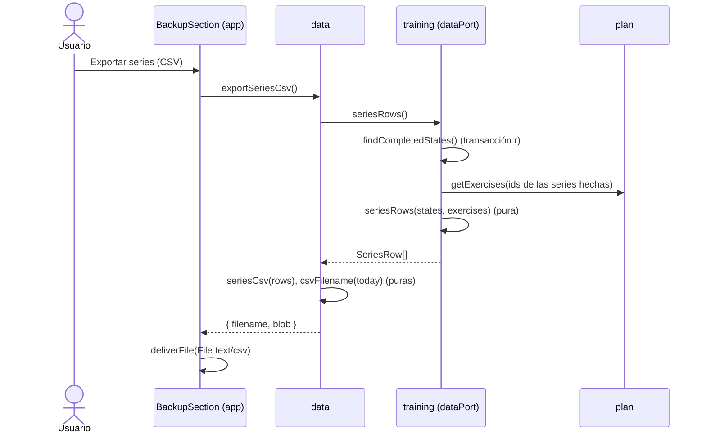

# Plan técnico: Exportar las series a CSV

**Spec:** `specs/008-csv/spec.md` · **Estado:** Aprobado · **Fecha:** 20-nov-2026

Contratos actualizados al aprobar: `shared.md` §2 (`SeriesRow`, `seriesRows?`), `data.md` v1.7 (`exportSeriesCsv`, detalle del CSV, decisión 7) y `training.md` v1.32 (RN-TRN-31, decisión 34).

## 1. Resumen de la solución

`training` arma las filas: una función pura de su dominio filtra las series hechas de las sesiones `completed`, las ordena y les pone el nombre y la `metric` del ejercicio, que lee de `plan` con `getExercises`. Las entrega por un método nuevo de su `DataPort`, `seriesRows()`, con un tipo `SeriesRow` del kernel. `data` convierte esas filas en el texto CSV (encabezados, BOM, CRLF, comillas RFC 4180) con otra función pura y le pone el nombre con la versión del formato. Ajustes añade el botón y entrega el archivo con `deliverFile`, igual que el respaldo.

Sin tablas, índices ni migración: la base sigue en la v3 (AC-31). El respaldo JSON no cambia de versión.

## 2. Módulos afectados

| Módulo | Cambio | ¿Cambia el contrato? |
|---|---|---|
| `shared` | `SeriesRow` en `kernel/data-port.ts`; `DataPort.seriesRows?()` reemplaza el borrador `csv?()` | Sí: `modules/shared.md` §2 |
| `training` | `domain/series.ts` (pura, `seriesRows`); `application/series.ts` (lee el repositorio y `plan`); el puerto la expone | Sí: `modules/training.md` v1.32 (RN-TRN-31) |
| `data` | `domain/csv.ts` (pura: `CSV_VERSION`, `CSV_COLUMNS`, `seriesCsv`, `csvFilename`); `exportSeriesCsv()` en el servicio | Sí: `modules/data.md` v1.7 |
| `app` | Botón y estado `exporting` en `BackupSection`; textos | No (no es un módulo) |
| `plan`, `health`, `progression` | Ninguno | No |

## 3. Cambios de contrato

**`shared` (§2):**

```ts
/** One done set of a completed workout, as the series CSV shows it (RN-DAT-14, RN-TRN-31). */
export interface SeriesRow {
  date: LocalDate;
  week: number | null;              // programWeek
  session: string;                  // Workout.name
  exercise: string;                 // current name of the set's exercise in the plan
  metric: 'weight' | 'reps' | 'time';
  setNumber: number;
  weightKg: number | null;          // negative = assistance
  reps: number | null;              // seconds when metric = 'time'
  rir: number | null;
  isExtra: boolean;
  completedAt: Instant | null;      // null only for tolerated broken data (RN-DAT-12)
}

interface DataPort<T = unknown> {
  // … igual que en la spec 007 …
  seriesRows?(): Promise<SeriesRow[]>;   // solo training; ya en el orden de RN-DAT-14
}
```

**`data` (v1.7, §5):**

```ts
interface DataApi {
  registerDataPort<T>(port: DataPort<T>): void;
  exportAll(): Promise<{ filename: string; blob: Blob }>;
  exportSeriesCsv(): Promise<{ filename: string; blob: Blob }>;   // RF-40, RN-DAT-14
  previewImport(file: Blob): Promise<Result<PendingImport, DataError>>;
}
```

- `exportSeriesCsv` busca el único puerto con `seriesRows`; si no hay ninguno o hay más de uno, lanza (error de composición, como "sin puertos").
- No abre transacción: el puerto lee lo suyo (§6.3). Si el puerto rechaza, la promesa rechaza (ADR-0010).
- `Blob` de tipo `text/csv` con el texto de `seriesCsv(rows)`; nombre `csvFilename(clock.today())`.

**`training` (v1.32), RN-TRN-31 nueva:**

> **Filas del CSV de series** (`dataPort.seriesRows()`, spec 008): una `SeriesRow` por serie `done` de cada workout `completed`, ordenadas por `date` ascendente, luego `startedAt` ascendente (`compareInstants`, ADR-0009), luego el `order` del ítem cuyo `exerciseId` es el de la serie y luego `setNumber`. `exercise` y `metric` salen del ejercicio de la serie (`SetLog.exerciseId`, el que se usó, RN-PLN-11) leído con `plan.getExercises`; `completedAt` es `null` si la serie no lo tiene. Función pura `seriesRows(states, exercises)` en `domain/series.ts`. Casos de borde en §6.4.

## 4. Datos

- Sin tablas, índices ni versión de Dexie nuevos.
- Sin cambio en el formato del respaldo JSON: `seriesRows` no es parte de `exportData` y la versión del puerto de `training` sigue en 1.
- La versión del formato CSV es `CSV_VERSION = 1` en `data/domain/csv.ts` (ADR-0013).

## 5. Flujo



## 6. Decisiones

### 6.1 Reparto entre módulos (decisión 1, aprobada)

`training` da filas tipadas y `data` escribe el archivo (opción 1, aprobada el 20-nov). Las columnas, su orden y la versión viven juntas en `data`; si `SeriesRow` cambia, TypeScript obliga a revisar `seriesCsv`, que es cuando hay que subir `CSV_VERSION`. Se descartaron que `training` lo hiciera todo (formato y versión fuera de `data`, en contra de RN-DAT-14) y que lo armara `app` (se salta a `data` y pone lógica de dominio en la página).

### 6.2 `SeriesRow` en el kernel

Como `ImportFacts`, el tipo lo comparten `training` (lo produce) y `data` (lo consume), y ninguno puede importar al otro. `seriesRows?` es opcional en `DataPort`: `plan` y `health` no lo implementan.

### 6.3 Lectura sin transacción de `data`

`training` lee sesiones y series en su transacción `r` (`findCompletedStates`) y luego llama a `plan.getExercises` fuera de ella. No hace falta una transacción común: el plan no se edita en v0.x, el CSV no se importa y una sesión que se cierre a la vez entra o no entera, porque sus filas salen de la misma lectura. `data` no abre transacción porque no conoce las tablas de `plan` que lee `training`.

### 6.4 Casos de borde de RN-TRN-31

- (a) Solo `status === 'completed'` y `done === true`. Las series no hechas, `discarded` e `in_progress` no salen (AC-10, AC-24).
- (b) El `order` de una serie es el del ítem con su `exerciseId`, incluidas las extra (RN-TRN-10). Si una serie no tiene ítem, o su ejercicio no está entre los que devuelve `getExercises`, es un dato roto que la app no produce (RN-TRN-12, 13, RN-DAT-11): la función lanza y sale el aviso genérico.
- (c) `getExercises` se llama una vez con los `exerciseId` de las series que salen, sin repetidos. Sin sesiones `completed`, no se llama y el resultado es `[]` (AC-23).
- (d) Dos sesiones con el mismo `date` (RN-DAT-12): primero la de `startedAt` menor (AC-25). Mismo `date` y mismo `startedAt`: por `id` (UUIDv7, orden de creación).
- (e) Los valores van tal como están guardados: sin redondear el peso, sin quitar el signo de la asistencia y sin convertir los segundos.

### 6.5 Formato del CSV (`data/domain/csv.ts`)

- `CSV_COLUMNS`: las 11 claves de `SeriesRow` en el orden de RN-DAT-14; la línea de encabezados es `CSV_COLUMNS.join(',')`. Una prueba de tipos comprueba que `CSV_COLUMNS` tiene exactamente las claves de `SeriesRow`.
- Cada campo: `null` → vacío; número → `String(n)` (`62.5`, `100`, `-20`; `-0` da `0`); `boolean` → `true` o `false`; texto → tal cual, o entre comillas con las comillas duplicadas si lleva `,`, `"`, CR o LF.
- `seriesCsv(rows)`: `''` + encabezados + una línea por fila, cada una terminada en `\r\n`, también la última. Al codificar el `Blob`, el BOM sale como `EF BB BF` (AC-8).
- `csvFilename(today)`: `gym-series-v${CSV_VERSION}-${today}.csv`.

### 6.6 Página (`BackupSection`)

- Un estado más en la máquina de estados que ya existe: `{ kind: 'exporting' }`. Con cualquier estado distinto de `idle`, los tres botones quedan `disabled` (AC-5, como la spec 007 decisión 17 (a)).
- Al tocar: borra el mensaje (AC-7), pasa a `exporting` (texto "Preparando CSV…"), llama a `data.exportSeriesCsv()`, entrega con `deliverFile(new File([blob], filename, { type: 'text/csv' }))` y vuelve a `idle`. Sin mensaje de éxito (decisión 9). Si falla, vuelve a `idle` y muestra el texto genérico con `role="alert"` en la sección (AC-6), capturado ahí como en "Descargar respaldo".
- Textos nuevos en `settings/texts.ts`: `csvText` ("Para abrir tus series en una hoja de cálculo."), `exportCsv` ("Exportar series (CSV)") y `preparingCsv` ("Preparando CSV…").
- El párrafo va entre "Restaurar respaldo" y el botón nuevo; la zona de mensajes sigue al final (AC-1).

### 6.7 Presupuesto del bundle

Dos funciones pequeñas y tres textos; sin dependencias nuevas. Se mide en la tarea de la página (AC-29).

## 7. Estrategia de pruebas

Pruebas primero en las dos funciones puras y en el servicio (commit en rojo local, como siempre).

| Criterio | Tipo de prueba | Archivo |
|---|---|---|
| RN-TRN-31, AC-10, 11, 13 a 17, 19, 20, 23 a 25 | Unitaria (dominio de `training`) | `modules/training/__tests__/series.test.ts` |
| RN-TRN-31 (c), lectura | Integración con `fake-indexeddb` y un `PlanReader` falso | `modules/training/__tests__/series-port.test.ts` |
| RN-DAT-14, AC-8, 9, 12, 18, 21 | Unitaria (dominio de `data`) y de tipos (`CSV_COLUMNS`) | `modules/data/__tests__/csv.test.ts`, `csv.test-d.ts` |
| `exportSeriesCsv` (uno, ninguno o dos puertos; rechazo; tipo y nombre) | Unitaria del servicio | `modules/data/__tests__/data-service.test.ts` |
| AC-26 (solo lectura), AC-12 con módulos reales | Integración con los módulos reales | `app/__tests__/series-csv.test.ts` |
| AC-1, 5, 6, 7 | Componente (Testing Library) | `app/__tests__/settings-page.test.tsx` |
| AC-2 a 4 | Ya cubiertos por las pruebas de `deliverFile` (spec 007); aquí, que la página pasa un `File` `text/csv` con el nombre | `app/__tests__/settings-page.test.tsx` |
| AC-3, 28, 30 | E2E: cerrar una sesión, exportar y leer el archivo descargado (BOM, encabezados, una fila); sin conexión; sin violaciones de CSP | `tests/e2e/backup.spec.ts` |
| AC-27 | E2E axe a tamaño normal y a 320 px (`/ajustes` ya está en `PAGES`) | `tests/e2e/a11y.spec.ts` |
| AC-29 | `npm run size` | CI |
| AC-31 | Sin cambio de `db.ts`; la prueba de la versión de la base sigue igual | `app/__tests__/db.test.ts` |
| AC-22 | Manual: abrir el CSV en Numbers en el Mac o el iPhone y en Google Sheets | Tarea de verificación |
| AC-2, 4 en Safari | Manual en el iPhone: la hoja de compartir con el `.csv` | Tarea de verificación |

## 8. Riesgos

- **La hoja de compartir de iOS con `text/csv`:** `canShare` podría no aceptar el tipo; entonces descarga (AC-3), que en iOS abre una vista previa con botón de compartir. Se verifica en el iPhone.
- **Excel en otra configuración regional** (coma decimal) abriría el CSV en una sola columna o leería `62.5` como texto. Fuera de alcance (spec §2); Numbers y Sheets lo leen bien.
- **Subir `CSV_VERSION`:** depende de que quien cambie `SeriesRow` o `CSV_COLUMNS` lo recuerde. Lo vigila la prueba que fija la línea de encabezados (cambiarla obliga a tocar la prueba, donde un comentario lo recuerda).
- **Cambios de nombre de ejercicio** (plan editable, v1.0): el CSV usará el nombre actual (spec §7). Se acepta.

## 9. Checklist de la constitución

- [x] **P-1:** solo exporta lo guardado; ninguna salida sugiere ejercicios.
- [x] **P-2:** solo lectura (AC-26); sin cambio de esquema (AC-31); versión del formato en el nombre (ADR-0013).
- [x] **P-3:** cambios de contrato en §3 (`shared`, `data` v1.7, `training` v1.32 con RN-TRN-31), escritos antes del código.
- [x] **P-4:** `data` sigue sin importar módulos; `training` lee `plan` por su `PlanReader`; nadie toca tablas ajenas.
- [x] **P-5:** filas y texto CSV como funciones puras, con pruebas primero.
- [x] **P-6:** ≥ 44 px, axe y 320 px (AC-27); bundle (AC-29).
- [x] **P-7:** un método opcional en el puerto, un método en `DataApi`, un estado más en la página; sin dependencias.
- [x] **P-8:** no entran datos de fuera; `SeriesRow` tipado sin `any`; textos en español.
